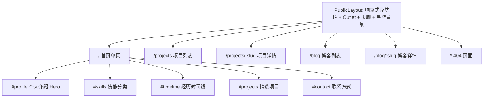
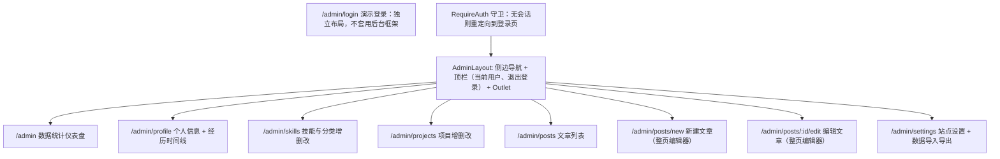
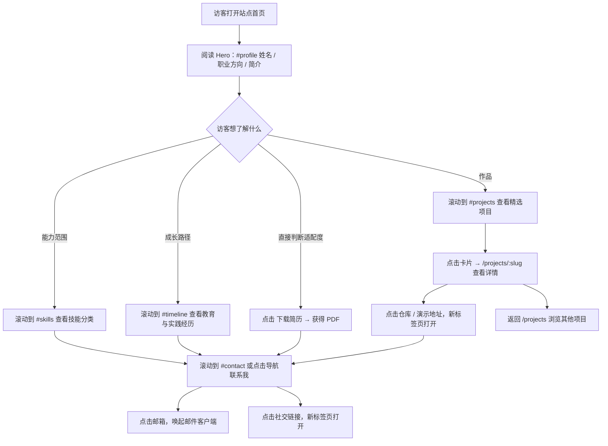
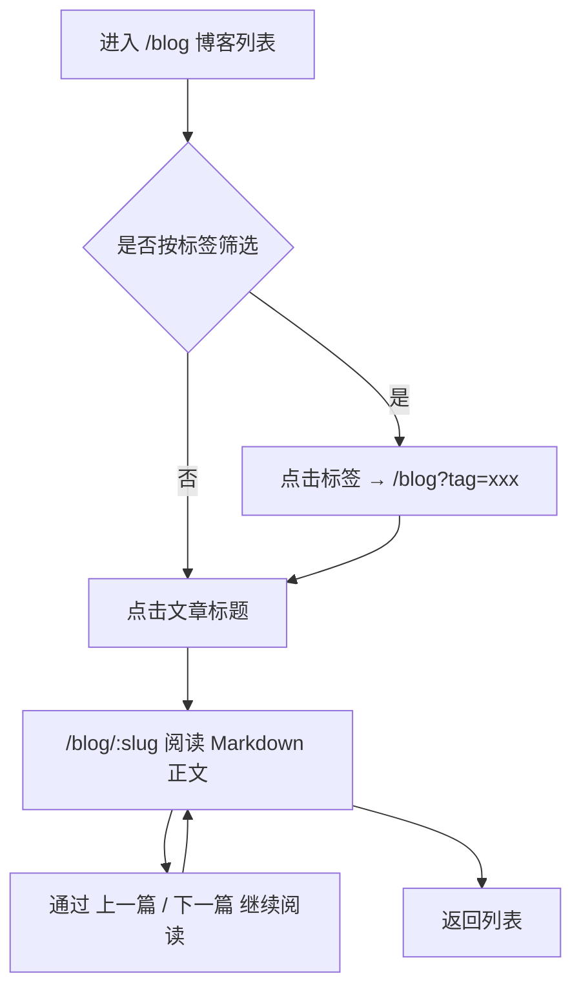
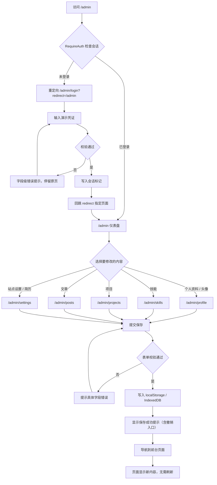
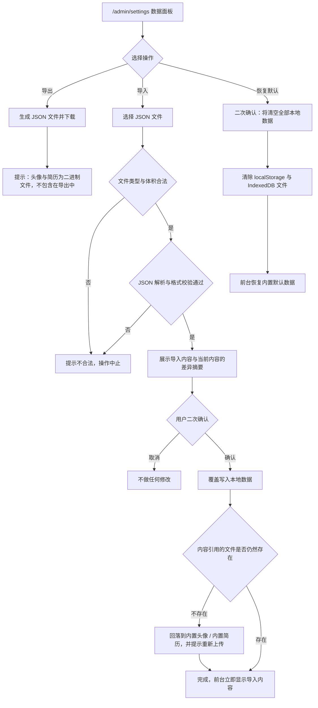
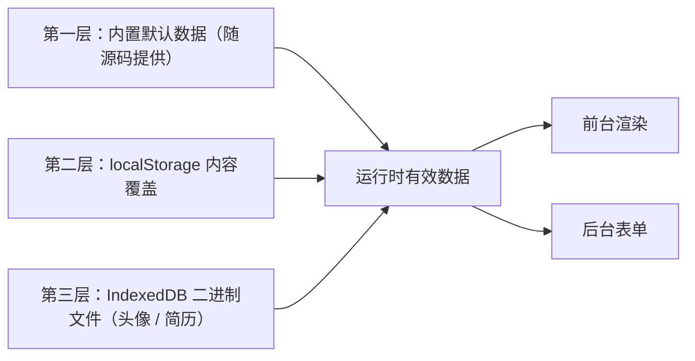

# PRD：个人数字作品集与内容管理网站

| 项目     | 内容                                                  |
| -------- | ----------------------------------------------------- |
| 文档版本 | v1.0                                                  |
| 文档类型 | 产品需求文档（PRD）                                   |
| 产品形态 | 纯前端单页应用（SPA），静态托管                       |
| 技术边界 | 不使用后端语言、不连接服务器数据库、不依赖云端存储    |
| 配套文档 | `TECH_DESIGN.md`（技术方案）、`AGENTS.md`（开发规范） |

> 本文档中所有路由路径、数据字段名与功能编号（F-xx / X-xx / AC-xx）为三份文档的共同契约。修改任何一项时，必须同步修改 `TECH_DESIGN.md` 与 `AGENTS.md`。

---

## 1. 产品目标

### 1.1 一句话定位

一个由个人自行维护内容、可直接静态托管上线、并在浏览器本地完成全部数据读写的个人作品集网站。

### 1.2 要解决的问题

| 问题                         | 现状                           | 本产品的做法                                               |
| ---------------------------- | ------------------------------ | ---------------------------------------------------------- |
| 简历无法体现项目深度         | PDF 简历只有一行项目名         | 提供项目详情页，可写背景、职责、技术方案与成果             |
| 作品集维护需要建站能力       | 改一行文案要找开发者或重新部署 | 提供 `/admin` 后台，在浏览器里改完即时生效                 |
| 课程作业需要展示完整工程能力 | 只有静态页面，无数据层         | 提供 localStorage + IndexedDB 的本地持久化与 JSON 导入导出 |

### 1.3 成功标准（可衡量）

1. 访客进入首页后 **30 秒内** 能回答三个问题：我是谁、我做过什么、如何联系我。
2. 从 `/admin` 登录到"修改个人简介 → 前台看到新文案"的完整操作 **不超过 5 步、无需刷新页面**。
3. 断网状态下，除首次加载外，前台浏览、后台增删改、简历下载 **全部可用**。
4. 首页在移动端 4G 网络下的首屏交互时间 **不超过 2.5 秒**（本地预览以 Lighthouse 移动端模拟为准）。
5. 全部色值与交互通过 WCAG 2.1 AA 检查（见 §8.4 对比度实测表）。

### 1.4 非目标（Non-goals）

本产品不追求：真实用户体系、多租户、内容审核、服务端渲染、SEO 排名、真实支付、真实后台安全。

---

## 2. 目标用户与画像

### 2.1 主用户：站点所有者（内容生产者）

| 维度     | 描述                                                                 |
| -------- | -------------------------------------------------------------------- |
| 身份     | 在校学生 / 求职者 / 需要展示作品的开发者                             |
| 技术能力 | 会使用浏览器与常见网页表单，**不需要**懂代码或部署                   |
| 使用频率 | 低频、突发式：投递简历前集中更新                                     |
| 设备     | 以桌面浏览器为主                                                     |
| 核心任务 | 更新个人简介与头像、新增项目、写一篇博客、替换简历 PDF、导出数据备份 |
| 痛点     | 不想学 Markdown 之外的格式；害怕误删内容；换电脑后内容丢失           |

**由此推导的产品要求**：表单要给出明确错误提示；删除要二次确认；必须支持导出备份与恢复默认数据。

### 2.2 次用户：访客（内容消费者）

| 维度     | 描述                                                       |
| -------- | ---------------------------------------------------------- |
| 身份     | 招聘方、评审老师、同行                                     |
| 停留时间 | 30 秒至 3 分钟                                             |
| 设备     | 桌面与手机各占一半，存在平板                               |
| 核心任务 | 快速判断能力水平、看项目细节、下载简历、找到联系方式并联系 |
| 痛点     | 手机端排版错乱；项目描述空洞；找不到简历下载入口           |

**由此推导的产品要求**：首屏必须包含姓名、职业方向、简历下载与联系入口；项目详情要有可验证的成果信息；三端排版均需验收。

### 2.3 第三用户：课程评审者（演示场景）

关注登录流程、数据持久化、导入导出、异常处理与文档完整性。因此后台的演示登录必须**明确标注为演示用途**，且异常路径（非法 JSON、超大文件、类型不符）必须有可见提示。

---

## 3. 功能范围

### 3.1 In Scope（本版本实现）

- 前台内容展示：个人介绍、技能分类、经历时间线、项目列表与详情、博客列表与详情、简历下载、联系方式、响应式导航与页脚。
- 后台管理：演示登录、数据统计仪表盘、个人信息管理（含头像上传预览）、技能与分类增删改、项目增删改、博客增删改（含 Markdown 编辑器）、站点设置（含简历上传替换）、数据导出 / 导入 / 恢复默认。
- 本地持久化：结构化内容存 `localStorage`，头像与简历文件存 `IndexedDB`。
- 默认展示数据随源码提供，首次访问无需任何配置即可看到完整站点。
- 交付三份文档：`PRD.md`、`TECH_DESIGN.md`、`AGENTS.md`。

### 3.2 Out of Scope（明确不做）

| 不做的事                           | 原因                           |
| ---------------------------------- | ------------------------------ |
| 真实后端 / API 服务                | 技术边界：纯前端               |
| 服务器数据库、云存储、云函数       | 同上                           |
| 注册、找回密码、多用户、权限角色   | 无后端；且演示不需要           |
| 生产级认证（JWT、OAuth、会话服务） | 见 §11 免责声明                |
| 服务端渲染（SSR）与预渲染          | 纯静态 SPA，静态托管即可       |
| 评论、点赞、阅读量上报             | 需要服务端                     |
| 图片裁剪、视频上传                 | 超出课程范围，头像只需缩放预览 |
| 多语言 i18n                        | 界面为中文单语言               |
| 真实邮件发送（联系表单提交）       | 改为提供邮箱与社交链接的直链   |

### 3.3 后续可选增强（不在本次验收内）

深色 / 浅色主题切换、Markdown 图片粘贴上传至 IndexedDB、标签页跨窗口实时同步的可视化提示、Playwright 端到端冒烟用例。

---

## 4. 功能需求清单

编号规则：`F-xx` 为功能点，`X-xx` 为横切需求。每个编号在 §9 有对应验收标准。

### 4.1 前台功能

| 编号 | 功能                     | 描述                                                                                            | 入口                         | 数据依赖                                     |
| ---- | ------------------------ | ----------------------------------------------------------------------------------------------- | ---------------------------- | -------------------------------------------- |
| F-01 | 首页个人介绍             | 首屏展示头像、姓名、职业方向、个人简介；提供"下载简历"与"联系我"两个主行动按钮                  | `/` 的 `#profile` 区块       | `Profile`                                    |
| F-02 | 技能分类展示             | 按分类分组展示技能，每项技能含名称与熟练度（1–5 级）；分类内按 `order` 排序                     | `/` 的 `#skills` 区块        | `SkillCategory`、`Skill`                     |
| F-03 | 教育及个人经历时间线     | 按时间倒序展示教育与实践经历，区分"教育"与"经历"两类；`endDate` 为空显示为"至今"                | `/` 的 `#timeline` 区块      | `TimelineItem`                               |
| F-04 | 项目经历展示（首页精选） | 首页展示 `featured === true` 的项目卡片，最多 3 个，按 `order` 排序；卡片含标题、摘要、技术标签 | `/` 的 `#projects` 区块      | `Project`                                    |
| F-05 | 项目列表页               | 展示全部项目，支持按分类筛选；每条链接至详情页                                                  | `/projects`                  | `Project`                                    |
| F-06 | 项目详情页               | 展示项目背景、我的职责、起止时间、技术栈、成果要点与 Markdown 正文；可跳转仓库 / 演示地址       | `/projects/:slug`            | `Project`                                    |
| F-07 | 博客列表                 | 展示已发布文章，含标题、摘要、日期、标签、预计阅读时长；支持按标签筛选与分页                    | `/blog`                      | `Post`、`SiteSettings.postsPerPage`          |
| F-08 | 博客详情                 | 渲染 Markdown 正文，展示元信息与上一篇 / 下一篇导航                                             | `/blog/:slug`                | `Post`                                       |
| F-09 | PDF 简历下载             | 前台任意页面可下载简历；下载文件为管理员上传的版本，缺省时使用内置简历                          | 首页 `#profile` 与页脚       | `SiteSettings.resumeAssetId`、IndexedDB 资源 |
| F-10 | 联系方式                 | 展示邮箱、手机（可选）、所在城市与社交链接，均为可直接点击的链接                                | `/` 的 `#contact` 区块、页脚 | `Profile`                                    |
| F-11 | 响应式导航栏             | 桌面端横向导航；移动端折叠为抽屉菜单，支持键盘操作与 Esc 关闭；站点标题旁常驻"登录后台"入口     | 全站顶部                     | —                                            |
| F-12 | 页脚                     | 版权文字、站点标题、社交链接、简历下载入口；内容来自站点设置                                    | 全站底部                     | `SiteSettings`、`Profile`                    |

### 4.2 后台功能（全部位于 `/admin` 下）

| 编号 | 功能                     | 描述                                                                                                                 | 入口                                                        | 关键字段                                |
| ---- | ------------------------ | -------------------------------------------------------------------------------------------------------------------- | ----------------------------------------------------------- | --------------------------------------- |
| F-13 | 演示登录                 | 使用固定演示凭证登录，登录后在会话内保持登录态；未登录访问后台自动跳转到登录页                                       | `/admin/login`                                              | 凭证为源码常量（见 §11）                |
| F-14 | 数据统计仪表盘           | 展示概览卡片：技能数、项目数、文章数（含草稿数）、最近更新时间；列出最近 5 篇草稿与最近修改的 3 个项目               | `/admin`                                                    | 全部集合的派生统计                      |
| F-15 | 个人信息管理             | 编辑姓名、职业方向、个人简介、邮箱、手机、城市、社交链接；上传头像并即时预览；管理经历时间线（教育与实践）的增删改   | `/admin/profile`                                            | `Profile`、`SocialLink`、`TimelineItem` |
| F-16 | 技能管理                 | 分类的新增 / 改名 / 删除（删除分类需先确认其下技能去向）；技能的新增 / 修改 / 删除 / 调整顺序与熟练度                | `/admin/skills`                                             | `SkillCategory`、`Skill`                |
| F-17 | 项目管理                 | 项目的新增 / 修改 / 删除；设置摘要、职责、时间、技术栈、成果要点、Markdown 正文、外链、是否首页精选、排序            | `/admin/projects`                                           | `Project`                               |
| F-18 | 博客管理                 | 文章的新增 / 修改 / 删除；编辑 Markdown 正文并实时预览；设置标题、摘要、标签、发布日期、草稿 / 发布状态              | `/admin/posts`、`/admin/posts/new`、`/admin/posts/:id/edit` | `Post`                                  |
| F-19 | 站点设置与简历文件管理   | 编辑站点标题、站点描述、页脚文案、星空背景开关、博客每页条数；上传 / 替换 / 删除简历 PDF 并显示当前文件名与大小      | `/admin/settings`                                           | `SiteSettings`、IndexedDB 资源          |
| F-20 | 数据导出、导入与恢复默认 | 导出全部内容为 JSON 文件并下载；导入 JSON 文件（校验后预览差异再确认写入）；恢复默认数据（清空本地数据回到内置数据） | `/admin/settings`                                           | 全部集合                                |

### 4.3 横切需求

| 编号 | 需求               | 说明                                                                                                                                                             |
| ---- | ------------------ | ---------------------------------------------------------------------------------------------------------------------------------------------------------------- |
| X-01 | 删除操作二次确认   | 所有破坏性操作（删除技能、分类、项目、文章、恢复默认、覆盖导入）必须弹出确认对话框；确认按钮文案描述具体后果（如"删除《xxx》"），不使用只有"确定/取消"的模糊文案 |
| X-02 | 表单校验           | 提交前校验；必填、长度、格式（邮箱、URL 协议）、数值范围逐项提示；错误定位到具体字段并附带可读文案；字段级即时校验与提交时全量校验并存                           |
| X-03 | 前后台数据即时同步 | 后台任何保存操作完成后，同标签页内导航到前台即显示新内容，无需手动刷新；跨标签页通过 `storage` 事件同步                                                          |
| X-04 | 三端响应式         | 断点覆盖手机（&lt;640px）、平板（640–1024px）、桌面（&gt;1024px）；三端均无横向滚动、无文字溢出、无遮挡；触控目标不小于 44×44px                                  |
| X-05 | 无障碍与动效偏好   | 键盘可达、焦点可见、图片有 alt、遵守 `prefers-reduced-motion`；满足 WCAG 2.1 AA（详见 §8.4）                                                                     |

---

## 5. 页面结构

### 5.1 前台路由树

| 路由              | 页面                   | 内容区块                                                                                      |
| ----------------- | ---------------------- | --------------------------------------------------------------------------------------------- |
| `/`               | 首页（单页，锚点跳转） | `#profile`、`#skills`、`#timeline`、`#projects`、`#contact`                                   |
| `/projects`       | 项目列表页             | 页面标题、分类筛选、项目卡片网格、空状态                                                      |
| `/projects/:slug` | 项目详情页             | 标题与摘要、元信息（时间 / 职责 / 分类）、技术栈、成果要点、Markdown 正文、外链按钮、返回列表 |
| `/blog`           | 博客列表页             | 页面标题、标签筛选、文章列表、分页、空状态                                                    |
| `/blog/:slug`     | 博客详情页             | 标题与元信息、Markdown 正文、上一篇 / 下一篇、返回列表                                        |
| `*`               | 404 页面               | 提示文案、返回首页链接                                                                        |

查询参数约定：`/blog?tag=<标签>` 与 `/blog?page=<页码>` 用于筛选与分页；`/` 的区块跳转使用锚点（`/#skills`）。

### 5.2 后台路由树

| 路由                    | 页面         | 编辑方式                | 说明                                                         |
| ----------------------- | ------------ | ----------------------- | ------------------------------------------------------------ |
| `/admin/login`          | 演示登录     | 表单                    | 独立布局，不套用后台框架；登录成功回跳 `?redirect=` 指定路径 |
| `/admin`                | 仪表盘       | 只读                    | 概览卡片与最近动态                                           |
| `/admin/profile`        | 个人信息管理 | 页面内表单 + 时间线列表 | 分两个标签页：「个人资料」与「经历时间线」                   |
| `/admin/skills`         | 技能管理     | 弹窗表单                | 分两个区域：「技能分类」与「技能列表」                       |
| `/admin/projects`       | 项目管理     | 抽屉表单                | 列表 + 右侧抽屉编辑，含 Markdown 正文文本框                  |
| `/admin/posts`          | 文章列表     | 列表 + 跳转             | 列表展示状态、标签、日期；操作按钮跳转到整页编辑器           |
| `/admin/posts/new`      | 新建文章     | 整页编辑器              | 左侧 Markdown 输入、右侧实时预览（移动端上下堆叠）           |
| `/admin/posts/:id/edit` | 编辑文章     | 整页编辑器              | 同上；`id` 不存在时显示未找到并返回列表                      |
| `/admin/settings`       | 站点设置     | 页面内表单 + 面板       | 含站点设置、简历文件管理、数据导入导出与恢复默认三个面板     |

**设计说明**：需求给定的后台路由为 7 个（含登录页）。技能与项目的编辑放在弹窗 / 抽屉中，因此不新增路由；博客正文较长，弹窗内无法容纳 Markdown 编辑器与预览，因此为文章编辑器新增 `/admin/posts/new` 与 `/admin/posts/:id/edit` 两个子路由，共 9 个后台路由。

---

## 6. 用户流程

### 6.1 访客：从进入首页到发起联系

### 6.2 访客：阅读博客

### 6.3 管理员：登录、修改内容并确认前台生效

### 6.4 管理员：数据备份与恢复

---

## 7. 数据与状态说明

### 7.1 三层数据来源与优先级

规则如下：

1. **首次访问**：`localStorage` 中不存在内容数据时，展示内置默认数据（源码随附的 TypeScript 数据与 Markdown 文章）。
2. **管理端保存后**：完整内容写入 `localStorage`；此后前台一律展示本地数据，不再混合内置数据。
3. **校验失败回落**：若本地数据结构不合法（被手动篡改或版本不匹配），视为"无本地数据"，回落到内置数据，并在开发控制台与页面上给出可见提示。
4. **二进制文件独立存放**：头像与简历的二进制内容存于 `IndexedDB`；内容数据中只保存资源标识（`avatarAssetId` / `resumeAssetId`）。文件缺失时回落到内置头像与内置简历。
5. **导出不含二进制**：导出的 JSON 仅含内容数据，不含头像与简历文件本体。在另一台设备导入后，头像与简历回落到内置资源，并提示用户重新上传。这是本次版本明确接受的限制。

### 7.2 即时同步要求（X-03）

- 前台与管理端共用同一份运行时状态，管理端保存完成后，同标签页内导航到前台即为最新内容，**不需要刷新页面**。
- 在另一个浏览器标签页打开前台时，通过浏览器的存储变更通知实现同步，延迟不超过 1 秒。
- 不允许出现"管理端显示已保存、前台仍是旧内容"的状态。

### 7.3 数据校验要求

- 表单校验、本地数据读取校验、导入文件校验使用**同一套规则定义**，避免出现"表单通过了但读取时报格式错误"。
- 校验失败必须给出可读的中文文案，指出字段名与实际约束（例如"项目标题不能超过 60 个字符"），而不是抛出技术异常。

---

## 8. 视觉与体验要求

### 8.1 视觉方向

现代、专业的深色个人作品集。关键词：克制、留白、清晰的排版层级、单一强调色。

### 8.2 色板（三份文档的共同色值来源）

| 语义       | 变量                    | 色值      | 用途                                      |
| ---------- | ----------------------- | --------- | ----------------------------------------- |
| 页面背景   | `--color-ink-900`       | `#0B0B0D` | 全局背景（深炭黑）                        |
| 面板背景   | `--color-ink-800`       | `#121216` | 卡片、侧边栏、输入框底                    |
| 分隔线     | `--color-ink-700`       | `#1F1F25` | 卡片描边、分隔线（装饰性）                |
| 输入框描边 | `--color-ink-600`       | `#6B6459` | 输入框默认边框（需满足 3:1 非文本对比度） |
| 主文字     | `--color-parchment-100` | `#F5F1E8` | 标题与正文（米白）                        |
| 次要文字   | `--color-parchment-300` | `#D8D2C4` | 辅助说明、元信息                          |
| 弱化文字   | `--color-parchment-500` | `#A9A29A` | 时间戳、占位符                            |
| 强调色     | `--color-champagne-400` | `#C9A96A` | 链接、按钮、焦点环（香槟金）              |
| 强调色浅   | `--color-champagne-200` | `#E3C88F` | 悬停态、强调数字                          |
| 危险色     | `--color-danger-400`    | `#E07A6B` | 删除操作与错误提示                        |

**禁止事项**：不得使用蓝紫渐变作为主视觉；不得在同一个页面引入第三个强调色；不得用强调色作为大面积背景（仅限按钮、描边、图标与小标题）。

### 8.3 排版与背景

- 字体：全站使用系统字体栈（含中文回退），**不引入网络字体**，避免第三方请求与首屏阻塞。层级通过字重、字号与字距表达。
- 星空背景：采用低成本的 CSS 分层径向渐变与静态星点，透明度低、不参与交互（不接收鼠标事件）、不对屏幕阅读器暴露（标记为装饰性）。在移动端与开启"减少动态效果"时降级为静态或直接关闭。后台也可通过站点设置开关关闭。
- 文字可读性优先：星空背景不得落在正文或表单区域内，正文区域使用不透明面板承托。
- 动效：仅使用透明度与位移类过渡，时长不超过 300ms，不使用持续动画循环。

### 8.4 无障碍要求（WCAG 2.1 AA）

**对比度实测（针对 `#0B0B0D` 背景，按 WCAG 相对亮度公式计算）**

| 前景 / 背景           | 对比度    | 结论                                 |
| --------------------- | --------- | ------------------------------------ |
| `#F5F1E8` / `#0B0B0D` | 约 17.4:1 | 通过 AA 与 AAA                       |
| `#D8D2C4` / `#0B0B0D` | 约 13.1:1 | 通过 AA 与 AAA                       |
| `#A9A29A` / `#0B0B0D` | 约 8.0:1  | 通过 AA 与 AAA（可用于正文）         |
| `#C9A96A` / `#0B0B0D` | 约 9.5:1  | 通过 AA 与 AAA（链接、小标题可用）   |
| `#0B0B0D` / `#C9A96A` | 约 9.5:1  | 通过 AA（金色按钮上用深色文字）      |
| `#6B6459` / `#0B0B0D` | 约 3.4:1  | 非文本对比度达标（输入框边框、图标） |

> 实现提示：`--color-ink-700` 与 `--color-ink-800` 对比度不足 3:1，只能用于纯装饰性分隔线与背景面板，**不得**作为输入框边框或唯一的状态指示。焦点指示统一使用香槟金。

**其他无障碍要求**

1. 提供"跳到主要内容"的跳过导航链接。
2. 使用语义化标签（`header`、`nav`、`main`、`section`、`article`、`footer`），页面标题层级不跳级。
3. 焦点状态可见：所有可交互元素具备 2px 香槟金焦点环与外偏移。
4. 键盘操作：移动端菜单可 Tab 进入、Esc 关闭、关闭后焦点回到触发按钮；弹窗与抽屉需将焦点限制在内部。
5. 表单：错误信息通过无障碍属性关联到具体输入框，错误出现时通过礼貌级别实时区域播报。
6. 图片：头像与项目图片必须提供 alt；纯装饰图形标记为装饰性并排除。
7. 动态内容：保存成功、删除成功等提示使用实时区域播报。
8. 语言声明为中文（`lang="zh-CN"`）。
9. 遵守 `prefers-reduced-motion`：开启时关闭星空动画、移除位移过渡，仅保留不透明度变化。
10. 触控目标不小于 44×44px；正文行宽不超过约 75 个字符。

### 8.5 性能预算

| 指标                       | 预算                       |
| -------------------------- | -------------------------- |
| 首屏 JS（gzip 后）         | ≤ 200 KB                   |
| 首屏 CSS（gzip 后）        | ≤ 40 KB                    |
| 静止态无持续动画与动画循环 | 必须满足                   |
| 后台代码不进入首屏包       | 必须满足（路由级代码分割） |

---

## 9. 验收标准

格式：**给定**（前置条件）— **当**（操作）— **则**（可观察结果）。编号 `AC-<功能编号>-<序号>`。

### 9.1 前台功能

**AC-F01 首页个人介绍**

- 给定 首次访问且本地无数据，当 打开 `/`，则 首屏可见头像、姓名、职业方向与个人简介，且"下载简历""联系我"两个主行动按钮同时可见。
- 给定 管理端已将姓名改为"张三"，当 导航到 `/`，则 首屏立即显示"张三"，无需刷新。
- 给定 个人简介为空，当 打开 `/`，则 隐藏简介段落且不出现空白占位或乱码。

**AC-F02 技能分类展示**

- 给定 存在 3 个分类共 10 项技能，当 打开 `/#skills`，则 10 项技能按分类分组显示，组内按顺序排列，熟练度以 5 格以内的可视化呈现。
- 给定 某个分类下无技能，当 查看首页，则 不渲染该分类的空标题。
- 给定 无任何技能数据，当 查看首页，则 显示"暂无技能"的空状态而不是报错。

**AC-F03 教育及个人经历时间线**

- 给定 存在教育与实践两类共 4 条记录，当 打开 `/#timeline`，则 按时间倒序展示，教育与实践有可区分的标识。
- 给定 一条记录的结束时间为空，当 查看时间线，则 该条显示为"至今"。
- 给定 起止时间格式为年月，当 查看时间线，则 统一展示为形如"2023.09 — 2025.06"的格式，不出现原始时间戳。

**AC-F04 项目经历展示（首页精选）**

- 给定 4 个项目，其中 2 个标记为首页精选，当 打开 `/#projects`，则 首页仅显示这 2 个，按顺序排列。
- 给定 5 个项目均标记为精选，当 打开 `/#projects`，则 最多显示 3 个，并出现"查看全部项目"链接指向 `/projects`。

**AC-F05 项目列表页**

- 给定 存在 5 个项目分属 2 个分类，当 打开 `/projects`，则 显示全部 5 个；点击分类筛选后仅显示该分类项目。
- 给定 项目数据为空，当 打开 `/projects`，则 显示空状态文案与返回首页链接。

**AC-F06 项目详情页**

- 给定 存在 slug 为 `campus-map` 的项目，当 打开 `/projects/campus-map`，则 显示标题、摘要、职责、时间、技术栈、成果要点与 Markdown 正文。
- 给定 项目正文含 Markdown 标题、列表、代码块与表格，当 查看详情页，则 内容按预期渲染，且不执行任何脚本（Markdown 中的脚本内容以纯文本显示）。
- 给定 项目正文包含 `javascript:` 伪协议链接，当 查看详情页，则 该链接不可点击或被消毒为普通文本。
- 给定 slug 不存在，当 打开 `/projects/not-exist`，则 显示项目未找到页面并提供返回列表入口。
- 给定 项目设置了仓库与演示地址，当 点击外链，则 在新标签页打开，且不向目标站点传递来源控制权。

**AC-F07 博客列表**

- 给定 存在 8 篇文章其中 2 篇为草稿，当 打开 `/blog`，则 仅显示 6 篇已发布文章，草稿不出现在前台。
- 给定 每页条数设置为 6 且存在 7 篇已发布文章，当 打开 `/blog`，则 第一页显示 6 篇并提供第二页入口，页码通过查询参数反映在地址栏。
- 给定 点击标签"前端"，当 列表更新，则 地址栏为 `/blog?tag=前端`，列表仅显示该标签文章。
- 给定 文章摘要较长，当 在移动端查看，则 摘要按行数截断并显示省略号，不撑破卡片布局。

**AC-F08 博客详情**

- 给定 存在已发布文章，当 打开 `/blog/<slug>`，则 显示标题、发布日期、标签、预计阅读时长与渲染后的正文。
- 给定 文章为草稿状态，当 直接打开其详情地址，则 显示未找到页面（前台不可访问草稿）。
- 给定 该文章存在上一篇与下一篇，当 查看详情页底部，则 显示对应标题链接；若不存在则不渲染对应链接。

**AC-F09 PDF 简历下载**

- 给定 管理员已上传简历 `resume-2026.pdf`，当 点击任意位置的"下载简历"，则 浏览器下载该文件，文件名保留原文件名。
- 给定 管理员未上传简历，当 点击"下载简历"，则 下载内置简历，功能不报错。
- 给定 内置简历与已上传简历都不存在，当 点击"下载简历"，则 显示提示"简历暂不可用，请稍后再试"并且不产生空文件下载。

**AC-F10 联系方式**

- 给定 已填写邮箱，当 查看 `#contact`，则 邮箱为可点击链接并唤起邮件客户端。
- 给定 未填写手机号或城市，当 查看 `#contact`，则 对应条目完全不渲染，不出现"未填写"占位。
- 给定 社交链接使用了非 http/https 的协议，当 保存时，则 表单拒绝提交并提示协议不受支持。

**AC-F11 响应式导航栏**

- 给定 桌面宽度，当 查看站点，则 导航栏横向展示全部链接；滚动后导航栏保持可访问（吸顶或可回到顶部）。
- 给定 移动端宽度，当 查看站点，则 导航折叠为菜单按钮，展开后为覆盖式抽屉。
- 给定 移动端抽屉已展开，当 按下 Esc 或点击遮罩，则 抽屉关闭且焦点回到菜单按钮。
- 给定 使用键盘，当 依次按 Tab 遍历导航，则 每个链接的焦点环均可见，且不会聚焦到被折叠隐藏的元素。
- 给定 任意页面，当 查看导航栏，则 站点标题旁常驻"登录后台"入口，点击后进入 `/admin/login` 登录页。

**AC-F12 页脚**

- 给定 站点设置中页脚文案为"© 2026 张三"，当 查看任意页面，则 页脚显示该文案。
- 给定 当前年份变化，当 查看页脚，则 版权年份与站点设置一致，不出现写死年份。

### 9.2 后台功能

**AC-F13 演示登录**

- 给定 未登录，当 直接访问 `/admin/projects`，则 重定向到 `/admin/login?redirect=/admin/projects`。
- 给定 输入正确演示凭证，当 提交，则 登录成功并回跳到 `redirect` 指定页面；无 `redirect` 时回到 `/admin`。
- 给定 输入错误凭证，当 提交，则 停留在登录页并显示"账号或密码不正确"，不泄露哪一项错误。
- 给定 已登录，当 关闭标签页后重新打开站点，则 会话状态按会话存储的语义处理（当前浏览会话内保持，新会话需重新登录）。
- 给定 查看登录页，当 阅读页面，则 可见演示账号与密码；进入后台后顶栏可见"仅供课程演示"提示。
- 给定 已登录，当 点击退出登录，则 会话标记被清除并跳回登录页。

**AC-F14 数据统计仪表盘**

- 给定 有 12 项技能、5 个项目、7 篇文章（含 2 篇草稿），当 打开 `/admin`，则 概览卡片分别显示 12、5、7（并标注 2 篇草稿）。
- 给定 刚修改了某个项目，当 返回仪表盘，则 "最近修改"列表将该项目的更新时间置顶。
- 给定 无任何数据，当 打开仪表盘，则 统计显示 0 并给出"从新增技能开始"的引导，不显示报错。

**AC-F15 个人信息管理**

- 给定 在姓名输入框清空内容，当 提交，则 阻止提交并在该字段下显示"姓名不能为空"。
- 给定 在邮箱输入框输入 `abc`，当 提交，则 阻止提交并提示邮箱格式不正确。
- 给定 选择一张 1.5MB 的 PNG 头像，当 选择文件，则 在提交前即可看到圆形预览，保存后头像在前台更新。
- 给定 选择一张 3MB 的 PNG 头像（超出 2MB 限制），当 选择文件，则 拒绝该文件并提示体积上限，当前头像保持不变。
- 给定 选择一张 `.txt` 文件作为头像，当 选择文件，则 拒绝并提示仅支持 PNG、JPEG、WebP。
- 给定 在"经历时间线"标签页新增一条实践经历，当 保存，则 前台首页时间线立即出现该条且顺序正确。
- 给定 删除一条时间线记录，当 点击删除，则 弹出二次确认，确认后该条消失，取消则无任何变化。

**AC-F16 技能管理**

- 给定 新增技能时未选择分类，当 提交，则 阻止提交并提示需选择分类。
- 给定 两个技能同名，当 提交第二个，则 提示该名称已存在并阻止提交。
- 给定 删除一个分类，当 点击删除，则 确认弹窗说明该分类下的技能数量及其处理方式，确认后按说明执行。
- 给定 删除一项技能，当 点击删除，则 弹出包含技能名称的二次确认，确认后原地移除并提示"已删除，可撤销"。
- 给定 调整技能顺序，当 保存，则 前台技能展示顺序同步变化。

**AC-F17 项目管理**

- 给定 新增项目时填写的 slug 与已有项目重复，当 提交，则 阻止提交并提示 slug 已被占用。
- 给定 新增项目时 slug 留空，当 提交，则 自动由标题生成 slug（中文标题需生成可读的稳定标识）并提示已生成。
- 给定 未填写"成果要点"，当 保存，则 允许保存（该字段非必填），但详情页不渲染空列表。
- 给定 填写了 `demoUrl` 为 `ftp://x`，当 提交，则 阻止提交并提示仅支持 http/https。
- 给定 打开项目抽屉编辑并修改标题，当 在抽屉关闭前点击遮罩或 Esc，则 若有未保存修改需提示确认放弃，避免误丢内容。
- 给定 删除一个项目，当 确认删除，则 该项目从前台列表与详情页同时消失，直接访问原详情地址显示未找到。

**AC-F18 博客管理**

- 给定 在编辑器中输入 Markdown，当 内容变化，则在预览区近实时看到渲染结果（输入停止后的短时间内更新）。
- 给定 文章状态为草稿，当 保存，则 前台列表不显示该文章，后台列表标注为草稿。
- 给定 未填写标题，当 保存，则 阻止保存并提示标题必填。
- 给定 在编辑器中输入包含 HTML 脚本标记的内容，当 查看预览与前台详情，则 脚本不执行，以文本形式呈现。
- 给定 编辑已有文章，当 修改并保存，则 更新"更新时间"字段，而原始发布日期保持不变。
- 给定 文章正文只有空白字符，当 保存为已发布，则 阻止保存并提示正文不能为空。

**AC-F19 站点设置与简历文件管理**

- 给定 修改站点标题为"张三的作品集"，当 保存，则 浏览器标签页标题与页脚同步更新。
- 给定 上传一份 3MB 的 PDF，当 选择文件，则 保存成功并在"当前文件"区域显示文件名与体积。
- 给定 上传一份 8MB 的 PDF（超出 5MB 限制），当 选择文件，则 拒绝并提示体积上限。
- 给定 上传一份 `.docx` 文件，当 选择文件，则 拒绝并提示仅支持 PDF。
- 给定 已上传简历，当 点击"预览"，则 在页面内嵌区域显示 PDF 内容而无需下载。
- 给定 已上传简历，当 点击"删除简历"，则 二次确认后删除，前台下载回落为内置简历。
- 给定 关闭星空背景开关，当 保存，则 全站星空背景消失，文字对比度不受影响。

**AC-F20 数据导出、导入与恢复默认**

- 给定 已有本地修改数据，当 点击"导出 JSON"，则 下载一个含版本号与导出时间的 JSON 文件，且导出内容为当前内容数据（不含头像与简历二进制文件），界面上有相应说明。
- 给定 选择一个体积超过 2MB 的 JSON，当 导入，则 拒绝并提示体积上限，现有数据不变。
- 给定 选择一个内容为非 JSON 的文本文件，当 导入，则 提示"文件格式无法解析"，现有数据不变。
- 给定 选择一个 JSON 但缺少必要字段，当 导入，则 提示具体缺失或非法的字段，现有数据不变。
- 给定 选择合法 JSON，当 导入前，则 先展示与当前数据的差异摘要（各集合数量变化与更新时间），需用户确认后才写入。
- 给定 确认导入，当 写入完成，则 前台立即显示导入的内容。
- 给定 导入内容引用了不存在的头像或简历文件，当 写入完成，则 显示回落到内置资源的提示并引导重新上传。
- 给定 本地已有大量修改，当 点击"恢复默认数据"，则 出现二次确认并明确说明将清空全部本地数据；确认后本地数据与文件被清除，前台显示内置默认数据；取消则无任何变化。

### 9.3 横切需求

**AC-X01 删除二次确认**

- 给定 任意删除入口，当 点击删除，则 首次点击不产生删除，必须先经过确认对话框。
- 给定 确认对话框，当 阅读文案，则 能明确知道删除对象与后果，且危险操作按钮与取消按钮在视觉上可区分。
- 给定 确认对话框打开，当 按下 Esc 或点击取消，则 关闭并保留原数据。

**AC-X02 表单校验**

- 给定 提交含多个错误的表单，当 提交，则 一次性列出全部字段错误，焦点移动到第一个错误字段。
- 给定 字段存在错误，当 修正内容，则 该字段的错误提示即时消失。
- 给定 校验失败，当 阅读提示，则 文案明确说明字段名与约束，不使用技术术语或英文异常信息。

**AC-X03 前后台数据即时同步**

- 给定 在 `/admin/profile` 保存新简介，当 导航到 `/`，则 首屏显示新简介，全程未刷新页面。
- 给定 在标签页 A 修改数据，当 在标签页 B 查看前台，则 1 秒内显示更新后的内容。
- 给定 管理端显示"保存成功"，当 刷新页面，则 数据仍然存在（确实已持久化，而非仅内存生效）。

**AC-X04 三端响应式**

- 给定 视口宽度 375px、768px、1440px，当 逐一查看全部前台与后台页面，则 均无横向滚动条、无文字截断、无元素重叠。
- 给定 移动端后台文章编辑器，当 查看页面，则 输入区与预览区上下堆叠且各自可正常滚动。
- 给定 移动端，当 点击任意按钮或链接，则 触控区域不小于 44×44px。

**AC-X05 无障碍与动效偏好**

- 给定 使用键盘操作全站，当 依次 Tab 遍历，则 全部交互元素可达且焦点环可见，不存在仅鼠标可用的功能。
- 给定 系统开启"减少动态效果"，当 浏览站点，则 星空背景停止动画、过渡位移被移除（或整体动效关闭），内容与功能不受影响。
- 给定 使用屏幕阅读器，当 浏览首页，则 头像被朗读为带有姓名的有意义描述，装饰性的星空背景不被朗读。
- 给定 保存操作完成，当 使用屏幕阅读器，则 保存结果被礼貌级别播报。
- 给定 按 §8.4 表格核对全部文字与背景组合，则 正文与交互文字对比度不低于 4.5:1，非文本指示不低于 3:1。

---

## 10. 交付范围与依赖

| 交付物           | 说明                                                                                                                                                         |
| ---------------- | ------------------------------------------------------------------------------------------------------------------------------------------------------------ |
| `PRD.md`         | 本文档                                                                                                                                                       |
| `TECH_DESIGN.md` | 技术栈、目录结构、路由、数据模型、存储与部署方案                                                                                                             |
| `AGENTS.md`      | 开发规范与逐功能自检要求                                                                                                                                     |
| 站点源码         | 按 `TECH_DESIGN.md` 的目录结构实现，实现阶段产出                                                                                                             |
| 内置默认数据     | 个人资料、技能、经历、项目、示例博客、内置简历 PDF（人物为站点所有者本人，仅含姓名、公开邮箱与公开主页链接；内置简历为本人简历文件，经本人确认后随仓库发布） |

外部依赖：无运行时第三方服务。构建与部署依赖 Node.js 与 Cloudflare Pages（免费静态托管）。

---

## 11. 免责声明与风险说明

### 11.1 演示级安全声明

- 后台登录为**演示登录**：演示凭证以常量形式硬编码在前端源码中，可在构建产物中被任何人查看。
- 登录状态仅用于界面分流（区分"是否能进入后台页面"），**不构成任何安全边界**。任何用户都可以通过浏览器开发者工具直接修改本地数据。
- 所有数据存储于浏览器本地（`localStorage` 与 `IndexedDB`），**未加密**，可被本机使用者读取与修改，也适用于同一浏览器的其他访问者。
- 因此本系统**不得**用于存放真实敏感信息：不上传身份证件、身份证号、真实住址、出生年月、账号密码等。内置默认数据只包含站点所有者本人的公开信息（姓名、公开邮箱、公开主页链接、就读院校与专业、教育与项目经历），内置简历为本人简历文件，经本人确认后随仓库发布。
- 数据仅存在于当前浏览器与当前设备：清空浏览器数据、更换浏览器或更换设备都会导致内容丢失，必须依赖导出 JSON 备份。

### 11.2 风险与应对

| 风险                                     | 影响 | 应对                                                    |
| ---------------------------------------- | ---- | ------------------------------------------------------- |
| 用户清空浏览器数据导致内容丢失           | 高   | 后台仪表盘与数据面板提示定期导出备份；提供导出入口      |
| 本地数据被手动篡改导致结构不一致         | 中   | 读取时统一校验，失败回落默认数据并提示                  |
| 导出文件在另一台设备导入后丢失头像与简历 | 中   | 导入后明确提示重新上传，并在界面与文档中说明该限制      |
| 星空背景影响滚动性能或文字可读性         | 中   | 纯 CSS 静态实现、移动端降级、可开关、正文使用不透明面板 |
| 后续版本新增字段导致旧本地数据不完整     | 中   | 数据信封携带版本号，读取时以默认值补齐新增字段          |
| 演示凭证被误认为真实安全机制             | 中   | 后台顶栏与三份文档中均显著声明                          |

---

## 12. 文档一致性契约

以下内容为 `PRD.md`、`TECH_DESIGN.md`、`AGENTS.md` 三份文档必须完全一致的部分，任何变更需同步三处：

1. **路由清单**：前台 6 个路径、后台 9 个路径（见 §5）。
2. **数据模型与字段名**：`Profile`、`SocialLink`、`SkillCategory`、`Skill`、`TimelineItem`、`Project`、`Post`、`SiteSettings`、`AssetRef`、`ContentState`（与 `TECH_DESIGN.md` §数据模型一致）。
3. **色板与对比度结论**：§8.2 与 §8.4 的色值为唯一来源。
4. **存储键与命名空间**：`portfolio:content:v1`、`portfolio:auth:v1`、IndexedDB 的 `portfolio-assets` 库与 `assets` 存储。
5. **容量与格式限制**：头像 PNG/JPEG/WebP 且 ≤ 2MB；简历仅 PDF 且 ≤ 5MB；导入 JSON ≤ 2MB。
6. **功能编号**：`F-01` 至 `F-20`、`X-01` 至 `X-05`，以及对应验收标准编号 `AC-*`。
