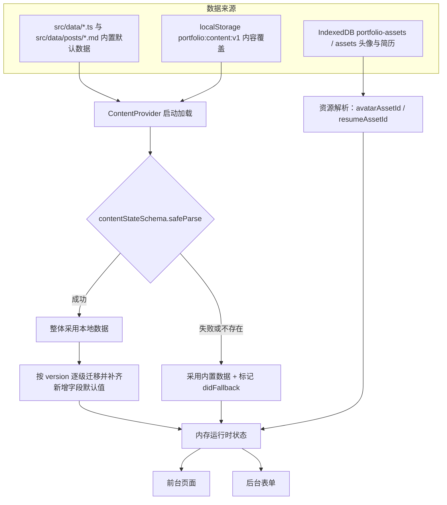
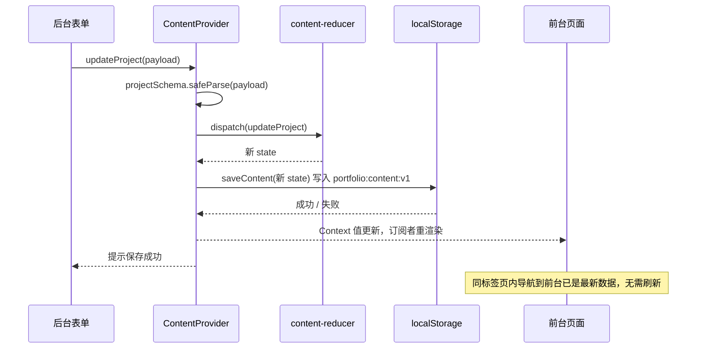
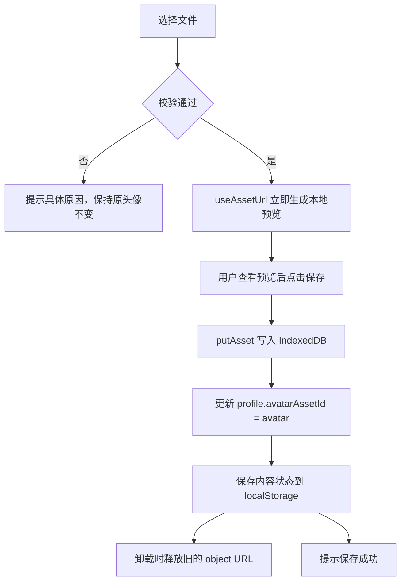
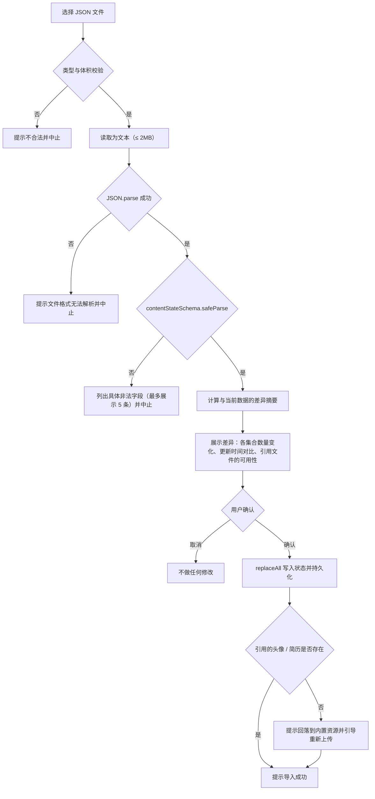

# TECH_DESIGN：个人数字作品集与内容管理网站技术方案

| 项目     | 内容                                               |
| -------- | -------------------------------------------------- |
| 文档版本 | v1.0                                               |
| 文档类型 | 技术设计文档                                       |
| 上游文档 | `PRD.md`（产品需求，功能编号 F-xx / X-xx / AC-xx） |
| 下游文档 | `AGENTS.md`（开发规范与自检要求）                  |
| 核心约束 | 纯前端；无后端语言、无服务器数据库、无云端存储     |

> 路由路径、字段名、色值、存储键、容量限制在本文档中给出的定义即为实现依据。与 `PRD.md` 的对应关系见文末 §15 一致性契约。

---

## 1. 技术栈

### 1.1 选型总表

| 领域           | 选型                                                                                                                   | 理由                                                                                                        | 被否决的替代方案                                                                                                |
| -------------- | ---------------------------------------------------------------------------------------------------------------------- | ----------------------------------------------------------------------------------------------------------- | --------------------------------------------------------------------------------------------------------------- |
| 构建工具       | Vite（最新稳定版）                                                                                                     | 开箱即用的 React + TS 支持、极快的开发服务器、静态产物易于托管                                              | Create React App（已停止维护）、Webpack 手写配置（对本项目过重）、Next.js（需要 Node 运行时，超出"纯前端"边界） |
| UI 库          | React 19                                                                                                               | 需求指定；生态与服务端渲染无关的组件模式成熟                                                                | Vue / Svelte（需求指定 React）                                                                                  |
| 语言           | TypeScript，`strict: true`                                                                                             | 数据模型复杂，需要编译期约束避免字段拼写与类型错误                                                          | JavaScript（无法保证跨模块字段一致性）                                                                          |
| 样式           | Tailwind CSS v4                                                                                                        | 需求指定；v4 通过 Vite 插件接入并使用 CSS-first 配置，无需独立的配置文件，构建产物仅含用到的类              | CSS Modules（需要手写大量重复样式）、styled-components（运行时开销）、Bootstrap（视觉风格与深色作品集方向不符） |
| 路由           | React Router v7（声明式/数据路由模式，`createBrowserRouter`）                                                          | 支持嵌套布局、索引路由、路由级懒加载与 404；纯客户端路由与静态托管完全兼容                                  | TanStack Router（类型更强但生态与文档量较小）、手写 hash 路由（无法支持深链与前进后退）                         |
| 数据校验       | Zod                                                                                                                    | 一套 schema 同时承担"TypeScript 类型来源""表单校验""本地数据校验""导入文件校验"四个职责，避免四套规则漂移   | Yup（类型推导弱于 Zod）、手写校验函数（重复且易漏）                                                             |
| Markdown 渲染  | `react-markdown` + `remark-gfm` + `rehype-sanitize`                                                                    | 渲染为 React 元素树而非 HTML 字符串，天然不执行脚本；GFM 提供表格与任务列表；`rehype-sanitize` 做白名单过滤 | 直接输出 HTML 字符串（需 `dangerouslySetInnerHTML`，禁止）、`marked` + 手动消毒（消毒逻辑容易写漏）             |
| IndexedDB 封装 | `idb-keyval`                                                                                                           | 体积极小（约 1KB），提供 Promise API，足够存放头像与简历两个文件                                            | 原生 IndexedDB（事务样板代码多）、Dexie（功能过剩）、localStorage 存 base64（体积膨胀且阻塞主线程）             |
| 表单状态       | 自研 `useForm` + Zod                                                                                                   | 表单结构简单（单对象、字段级错误），无需引入额外依赖；与 Zod 的错误对象直接对接                             | react-hook-form（可接受，但为一个后端无并发的纯本地表单引入额外依赖不划算）                                     |
| 测试           | Vitest + jsdom + React Testing Library + `@testing-library/user-event` + `fake-indexeddb`                              | 与 Vite 共用配置、启动快；可测试存储与校验等纯逻辑以及关键交互                                              | Jest（与 Vite 的 ESM 集成需额外配置）、仅手工测试（不满足 `AGENTS.md` 的测试要求）                              |
| 代码规范       | ESLint（flat config，含 `typescript-eslint`、`react-hooks`、`jsx-a11y`）+ Prettier（含 `prettier-plugin-tailwindcss`） | `jsx-a11y` 直接服务于无障碍验收；Tailwind 插件保证类名顺序稳定                                              | 仅 Prettier（不检查 hooks 依赖与无障碍）                                                                        |
| 部署           | Cloudflare Pages（静态托管）                                                                                           | 免费、支持 SPA 深链重写、支持预览部署与回滚、构建产物为纯静态文件                                           | GitHub Pages（SPA 深链需 hack 404 页面）、Vercel（本方案无服务端能力需求）                                      |

### 1.2 版本与 Node 环境

- 本机环境：Node v24.17.0、npm 11.13.0。脚手架阶段以 `npm create vite@latest` 生成的版本为准，并在 `package.json` 中锁定主版本（caret 范围内允许小版本更新）。
- 在 `.nvmrc` 中记录本地 Node 主版本，并在 Cloudflare Pages 的环境变量中显式设置 `NODE_VERSION`，避免构建环境使用过旧的 Node 导致 Tailwind v4 或 Vite 构建失败。
- 包管理器：npm（与本地环境一致），提交 `package-lock.json`。

### 1.3 运行时依赖清单（预期）

`react`、`react-dom`、`react-router`、`zod`、`idb-keyval`、`react-markdown`、`remark-gfm`、`rehype-sanitize`。

不引入：状态管理库（Context + `useReducer` 足够）、UI 组件库（视觉方向为定制深色风格）、日期库（仅需 `YYYY-MM` 与日期格式化）、图表库（仪表盘仅用数字卡片）。

---

## 2. 目录结构

```
4h/
├─ README.md                      # 使用说明、演示账号与部署步骤
├─ PRD.md                         # 产品需求文档
├─ TECH_DESIGN.md                 # 本文档
├─ AGENTS.md                      # 开发规范
├─ index.html                     # 入口 HTML（lang="zh-CN"、站点标题占位）
├─ package.json
├─ package-lock.json
├─ tsconfig.json                  # 聚合配置
├─ tsconfig.app.json              # 应用代码（strict）
├─ tsconfig.node.json             # 构建脚本类型
├─ vite.config.ts                 # React 插件 + @tailwindcss/vite + Vitest 配置
├─ eslint.config.js               # flat config + jsx-a11y（忽略 dist / .wrangler 等产物目录）
├─ .prettierrc.json
├─ .prettierignore                # 格式化范围排除构建产物与锁文件
├─ .nvmrc
├─ .gitignore
├─ public/                        # 原样拷贝到产物根目录
│  ├─ _redirects                  # 说明 Cloudflare Pages 的默认 SPA 深链行为（不声明规则）
│  ├─ _headers                    # 安全响应头
│  ├─ favicon.svg
│  ├─ default-avatar.jpg          # 未上传头像时的内置头像（本人照片）
│  └─ resume-sample.pdf           # 未上传简历时的内置简历（站点所有者本人的简历文件）
└─ src/
   ├─ main.tsx                    # 挂载 React 树（Providers + RouterProvider）
   ├─ index.css                   # @import "tailwindcss" + @theme 设计令牌
   ├─ vite-env.d.ts
   ├─ app/
   │  ├─ router.tsx               # createBrowserRouter 路由表（唯一路由来源）
   │  ├─ providers.tsx            # ContentProvider + ToastProvider + ConfirmProvider 组合
   │  └─ ErrorBoundary.tsx        # 渲染错误兜底（避免整站白屏）
   ├─ layouts/
   │  ├─ PublicLayout.tsx         # 前台框架：星空背景 + Header + Outlet + Footer
   │  ├─ SiteHeader.tsx
   │  ├─ SiteFooter.tsx
   │  ├─ MobileNav.tsx            # 移动端抽屉导航（焦点管理 + Esc）
   │  ├─ nav-links.ts             # 前台导航链接（头部与页脚共用）
   │  ├─ AdminLayout.tsx          # 后台框架：侧边导航 + 顶栏 + Outlet
   │  ├─ AdminSidebar.tsx
   │  └─ AdminTopbar.tsx          # 当前用户、退出登录、返回前台
   ├─ content/                    # 运行时状态层（前台与后台共用）
   │  ├─ ContentProvider.tsx      # 载入 + 校验 + 跨标签页订阅 + 持久化调度
   │  ├─ content-reducer.ts       # 纯函数 reducer（可单测）
   │  ├─ useContent.ts            # 对外唯一数据访问入口
   │  └─ selectors.ts             # 派生数据：精选项目、已发布文章、技能分组、统计
   ├─ data/                       # 第一层：内置默认数据
   │  ├─ index.ts                 # 汇总为 seedContent（ContentState）
   │  ├─ profile.ts
   │  ├─ skills.ts
   │  ├─ timeline.ts
   │  ├─ projects.ts
   │  ├─ settings.ts
   │  └─ posts/                   # Markdown + frontmatter，8 篇（含 1 篇草稿）
   ├─ lib/
   │  ├─ schema/                  # Zod schema（唯一真源）+ z.infer 类型
   │  │  ├─ primitives.ts         # yearMonth / isoDate / timestamp / httpUrl / slug
   │  │  ├─ profile.ts            # Profile / SocialLink
   │  │  ├─ skill.ts              # SkillCategory / Skill
   │  │  ├─ timeline.ts           # TimelineItem
   │  │  ├─ project.ts            # Project
   │  │  ├─ post.ts               # Post
   │  │  ├─ settings.ts           # SiteSettings
   │  │  ├─ asset.ts              # AssetRef / StoredAsset
   │  │  ├─ content-state.ts      # ContentState（含跨集合引用校验）
   │  │  └─ index.ts
   │  ├─ storage/
   │  │  ├─ content-store.ts      # localStorage 读写 + 校验 + 版本迁移 + 回落
   │  │  ├─ asset-db.ts           # IndexedDB 资源读写（idb-keyval）
   │  │  ├─ auth-store.ts         # 会话标记读写 + redirect 目标校验
   │  │  └─ transfer.ts           # 导出 / 导入 / 恢复默认
   │  ├─ markdown/
   │  │  ├─ renderer.ts           # react-markdown 组件与插件配置
   │  │  ├─ frontmatter.ts        # 从 Markdown 文件头解析元数据
   │  │  └─ reading-time.ts       # 中文阅读时长估算
   │  ├─ constants.ts             # 存储键、容量限制、演示凭证、默认分页
   │  ├─ date.ts                  # YYYY-MM / YYYY-MM-DD 解析与展示格式化
   │  ├─ slug.ts                  # slug 生成与去重
   │  ├─ file-validation.ts       # 文件类型 / 扩展名 / 体积校验
   │  ├─ resume.ts                # 简历来源解析（上传 → 内置简历 → 不可用）
   │  ├─ validation.ts            # Zod issues → 字段级中文提示
   │  ├─ diff.ts                  # 导入前的差异摘要计算
   │  └─ id.ts                    # crypto.randomUUID 封装
   ├─ hooks/
   │  ├─ useAssetUrl.ts           # Blob → object URL 并负责释放
   │  ├─ useForm.ts               # 基于 Zod 的表单状态与字段错误
   │  ├─ ConfirmProvider.tsx      # 命令式二次确认（配合 confirm-context.ts 的 useConfirm）
   │  ├─ ToastProvider.tsx        # 提示：实时区域播报、撤销入口（配合 toast-context.ts）
   │  ├─ useFocusTrap.ts          # 弹窗 / 抽屉焦点限制
   │  ├─ useMediaQuery.ts
   │  ├─ useDocumentTitle.ts      # 页面标题同步（含站点标题）
   │  └─ useHashScroll.ts         # /#skills 等锚点滚动
   ├─ components/
   │  ├─ ui/                      # 跨 feature 复用组件
   │  │  ├─ Button.tsx  button-styles.ts
   │  │  ├─ Input.tsx  Textarea.tsx  Select.tsx  Checkbox.tsx  control-styles.ts
   │  │  ├─ Field.tsx             # 标签 + 输入 + 错误提示（含无障碍关联）
   │  │  ├─ Modal.tsx  Drawer.tsx  DialogShell.tsx  ConfirmDialog.tsx  Tabs.tsx
   │  │  ├─ Badge.tsx  Card.tsx  EmptyState.tsx  Skeleton.tsx  Pagination.tsx
   │  │  └─ SkipLink.tsx          # "跳到主要内容"
   │  ├─ Starfield.tsx            # 星空背景（纯装饰）
   │  ├─ MarkdownView.tsx         # 统一 Markdown 渲染入口
   │  ├─ ResumeDownloadButton.tsx # F-09（首屏、页脚、移动端抽屉共用）
   │  ├─ PageHeader.tsx  SectionHeading.tsx
   │  └─ icons.tsx                # 内联 SVG 图标集
   ├─ features/
   │  ├─ home/
   │  │  ├─ HomePage.tsx
   │  │  ├─ HeroSection.tsx       # F-01
   │  │  ├─ SkillsSection.tsx     # F-02
   │  │  ├─ TimelineSection.tsx   # F-03
   │  │  ├─ ProjectsPreviewSection.tsx  # F-04
   │  │  └─ ContactSection.tsx    # F-10
   │  ├─ projects/
   │  │  ├─ ProjectListPage.tsx   # F-05
   │  │  ├─ ProjectDetailPage.tsx # F-06
   │  │  └─ ProjectCard.tsx
   │  ├─ blog/
   │  │  ├─ PostListPage.tsx      # F-07
   │  │  ├─ PostDetailPage.tsx    # F-08
   │  │  ├─ PostCard.tsx
   │  │  └─ TagFilter.tsx
   │  ├─ not-found/NotFoundPage.tsx
   │  └─ admin/
   │     ├─ LoginPage.tsx         # F-13
   │     ├─ RequireAuth.tsx       # 守卫：未登录重定向 + 外站 redirect 拒绝
   │     ├─ DashboardPage.tsx     # F-14
   │     ├─ profile/
   │     │  ├─ ProfilePage.tsx    # F-15（两个标签页）
   │     │  ├─ ProfileForm.tsx
   │     │  ├─ AvatarUploader.tsx
   │     │  ├─ TimelineManager.tsx
   │     │  └─ TimelineItemForm.tsx
   │     ├─ skills/
   │     │  ├─ SkillsPage.tsx     # F-16
   │     │  ├─ CategoryPanel.tsx  CategoryFormDialog.tsx
   │     │  └─ SkillPanel.tsx     SkillFormDialog.tsx
   │     ├─ projects/
   │     │  ├─ ProjectsPage.tsx   # F-17
   │     │  ├─ ProjectTable.tsx
   │     │  └─ ProjectFormDrawer.tsx
   │     ├─ posts/
   │     │  ├─ PostsPage.tsx      # F-18
   │     │  ├─ PostEditorPage.tsx
   │     │  └─ MarkdownEditor.tsx
   │     └─ settings/
   │        ├─ SettingsPage.tsx   # F-19 / F-20
   │        ├─ SiteSettingsForm.tsx
   │        ├─ ResumeManager.tsx
   │        └─ DataTransferPanel.tsx
   └─ test/
      ├─ setup.ts                 # RTL + jest-dom + fake-indexeddb 注册
      └─ helpers.ts               # 构造测试用 ContentState 的工厂函数
```

约定：

- 测试文件与被测文件同目录，命名为 `<被测文件名>.test.ts(x)`；上面的目录树省略了这些测试文件（当前共 18 个测试文件、167 个用例）。
- 每个 feature 目录内部自洽，跨 feature 复用的组件才上提到 `src/components/`。
- 任何模块都不得绕过 `src/content/useContent.ts` 直接读写 `localStorage` 或 IndexedDB（例外：`src/content/ContentProvider.tsx` 与 `src/lib/storage/*` 自身）。

---

## 3. 路由设计

### 3.1 路由表（唯一来源：`src/app/router.tsx`）

| 层   | 路径                    | 组件                       | 布局               | 对应 PRD          |
| ---- | ----------------------- | -------------------------- | ------------------ | ----------------- |
| 前台 | `/`                     | `HomePage`                 | `PublicLayout`     | F-01 ~ F-04、F-10 |
| 前台 | `/projects`             | `ProjectListPage`          | `PublicLayout`     | F-05              |
| 前台 | `/projects/:slug`       | `ProjectDetailPage`        | `PublicLayout`     | F-06              |
| 前台 | `/blog`                 | `PostListPage`             | `PublicLayout`     | F-07              |
| 前台 | `/blog/:slug`           | `PostDetailPage`           | `PublicLayout`     | F-08              |
| 前台 | `*`                     | `NotFoundPage`             | `PublicLayout`     | 404               |
| 后台 | `/admin/login`          | `LoginPage`                | 无（独立全屏布局） | F-13              |
| 后台 | `/admin`（index）       | `DashboardPage`            | `AdminLayout`      | F-14              |
| 后台 | `/admin/profile`        | `ProfilePage`              | `AdminLayout`      | F-15              |
| 后台 | `/admin/skills`         | `SkillsPage`               | `AdminLayout`      | F-16              |
| 后台 | `/admin/projects`       | `ProjectsPage`             | `AdminLayout`      | F-17              |
| 后台 | `/admin/posts`          | `PostsPage`                | `AdminLayout`      | F-18              |
| 后台 | `/admin/posts/new`      | `PostEditorPage`（create） | `AdminLayout`      | F-18              |
| 后台 | `/admin/posts/:id/edit` | `PostEditorPage`（edit）   | `AdminLayout`      | F-18              |
| 后台 | `/admin/settings`       | `SettingsPage`             | `AdminLayout`      | F-19、F-20        |

查询参数：`/blog?tag=<标签>`、`/blog?page=<页码>`。锚点：`/#profile`、`/#skills`、`/#timeline`、`/#projects`、`/#contact`。

### 3.2 路由实现

```tsx
// src/app/router.tsx（结构示意，非最终代码）
import { createBrowserRouter, Navigate } from 'react-router'
import { lazy, Suspense } from 'react'

const PublicLayout = lazy(() => import('../layouts/PublicLayout'))
const HomePage = lazy(() => import('../features/home/HomePage'))
// ...其余页面同样懒加载

// 后台整块只在前台之外按需加载，避免进入首屏包
const AdminLayout = lazy(() => import('../layouts/AdminLayout'))
const DashboardPage = lazy(() => import('../features/admin/DashboardPage'))
// ...

const withSuspense = (node: React.ReactNode) => <Suspense fallback={<Skeleton />}>{node}</Suspense>

export const router = createBrowserRouter([
  {
    element: withSuspense(<PublicLayout />),
    children: [
      { index: true, element: withSuspense(<HomePage />) },
      { path: 'projects', element: withSuspense(<ProjectListPage />) },
      { path: 'projects/:slug', element: withSuspense(<ProjectDetailPage />) },
      { path: 'blog', element: withSuspense(<PostListPage />) },
      { path: 'blog/:slug', element: withSuspense(<PostDetailPage />) },
      { path: '*', element: withSuspense(<NotFoundPage />) },
    ],
  },
  {
    path: 'admin/login',
    element: withSuspense(<LoginPage />), // 不套 AdminLayout
  },
  {
    path: 'admin',
    element: withSuspense(
      <RequireAuth>
        <AdminLayout />
      </RequireAuth>,
    ),
    children: [
      { index: true, element: withSuspense(<DashboardPage />) },
      { path: 'profile', element: withSuspense(<ProfilePage />) },
      { path: 'skills', element: withSuspense(<SkillsPage />) },
      { path: 'projects', element: withSuspense(<ProjectsPage />) },
      { path: 'posts', element: withSuspense(<PostsPage />) },
      { path: 'posts/new', element: withSuspense(<PostEditorPage mode="create" />) },
      { path: 'posts/:id/edit', element: withSuspense(<PostEditorPage mode="edit" />) },
      { path: 'settings', element: withSuspense(<SettingsPage />) },
    ],
  },
])
```

实现要点：

1. **布局通过 `element` 包裹 `Outlet` 实现**，不在子路由上重复声明布局；`PublicLayout` 渲染 `Starfield` + `SiteHeader`/`MobileNav`（F-11 响应式导航）+ `<main id="main">` + `SiteFooter`（F-12 页脚）。
2. **代码分割**使用 `React.lazy` + `Suspense`（稳定可用）。若脚手架阶段的 React Router 版本提供路由级 `lazy` 选项，可作为等价替代方案评估，但两者不可混用。
3. **锚点跳转**：`SiteHeader` 内链接使用标准 `Link`（如 `to="/#skills"`），由 `useHashScroll` 在路由变化后读取 `location.hash` 并滚动到目标元素；目标元素需带 `scroll-margin-top` 以避开吸顶导航。
4. **404 兜底**：`*` 路由挂在 `PublicLayout` 之下，因此 404 页面仍有导航与页脚。后台路径下的未知子路径由后台路由表兜底到 `/admin`（用 `{ path: '*', element: <Navigate to="/admin" replace /> }` 追加在后台 children 末尾）。
5. **`RequireAuth`** 包裹的是 `AdminLayout` 而非每个页面，保证守卫只执行一次：

```tsx
// src/features/admin/RequireAuth.tsx
export function RequireAuth({ children }: { children: React.ReactNode }) {
  const location = useLocation()
  const session = readSession() // sessionStorage 读取，不订阅
  if (!session) {
    const redirect = encodeURIComponent(location.pathname + location.search)
    return <Navigate to={`/admin/login?redirect=${redirect}`} replace />
  }
  return <>{children}</>
}
```

登录页在成功后读取 `searchParams.get('redirect')`，校验其必须以 `/admin` 开头（防止被构造成外站跳转），否则回退到 `/admin`。

6. **博客状态过滤**：`/blog/:slug` 在获取文章后若 `status !== 'published'`，渲染 `NotFoundPage` 而非内容（对应 AC-F08）。

---

## 4. 数据模型

### 4.1 设计原则

1. **Zod schema 是唯一真源**：TypeScript 类型全部由 `z.infer` 推导，不在别处手写 interface，避免类型与校验规则漂移。
2. **一套校验服务四处**：表单校验、`localStorage` 读取校验、导入文件校验、默认数据自检（开发期断言）复用同一 schema。
3. **未知字段丢弃**：使用普通 `z.object`（默认会剥离未知键），禁止使用 `passthrough` / `looseObject`，防止导入文件中的 `__proto__`、`constructor` 等键污染状态对象。
4. **引用完整性**：技能到分类、内容到资源文件的引用使用 `superRefine` 跨集合校验。

### 4.2 基础类型（`src/lib/schema/primitives.ts`）

```ts
import { z } from 'zod'

/** YYYY-MM，用于经历与项目的起止时间 */
export const yearMonth = z
  .string()
  .regex(/^\d{4}-(0[1-9]|1[0-2])$/, '格式应为 YYYY-MM，例如 2024-09')

/** YYYY-MM-DD，用于文章发布日期 */
export const isoDate = z
  .string()
  .regex(/^\d{4}-(0[1-9]|1[0-2])-(0[1-9]|[12]\d|3[01])$/, '格式应为 YYYY-MM-DD')

/** ISO 8601 时间戳（含时区），用于 updatedAt 等 */
export const timestamp = z.string().datetime({ offset: true })

/** 仅允许 http/https，阻断 javascript: 等伪协议 */
export const httpUrl = z
  .string()
  .url('请输入完整链接，例如 https://example.com')
  .refine((v) => /^https?:\/\//i.test(v), '仅支持 http 或 https 链接')

/** slug：小写字母、数字、汉字与连字符 */
export const slug = z
  .string()
  .min(1, '标识不能为空')
  .max(80, '标识不能超过 80 个字符')
  .regex(
    /^[\p{Script=Han}\p{Ll}\d]+(?:-[\p{Script=Han}\p{Ll}\d]+)*$/u,
    '标识只能包含小写字母、数字、汉字与连字符，且不能以连字符开头或结尾',
  )
```

### 4.3 实体 schema 与字段

**Profile / SocialLink**（`profile.ts`）

| 字段            | 类型               | 约束                                   | 说明                                             |
| --------------- | ------------------ | -------------------------------------- | ------------------------------------------------ |
| `name`          | string             | 1–40 字符，必填                        | 姓名                                             |
| `headline`      | string             | 1–60 字符，必填                        | 职业方向                                         |
| `bio`           | string             | ≤ 600 字符，必填                       | 个人简介，允许换行，前台按段落渲染               |
| `avatarAssetId` | `'avatar' \| null` | 可空                                   | 指向 IndexedDB 中的头像；`null` 表示使用内置头像 |
| `email`         | string             | 邮箱格式，必填                         | 联系邮箱                                         |
| `phone`         | string             | 可选，允许 6–20 位数字、空格、`+`、`-` | 手机号，为空则不渲染                             |
| `location`      | string             | 可选，≤ 40 字符                        | 所在城市，为空则不渲染                           |
| `socials`       | `SocialLink[]`     | 最多 6 项                              | 社交链接                                         |
| `updatedAt`     | timestamp          | 必填                                   | 最后修改时间                                     |

`SocialLink`：`id`（string，`crypto.randomUUID()`）、`label`（1–20 字符）、`url`（`httpUrl`）、`icon`（可选，取值限定为预定义图标名联合类型，避免任意字符串）。

**SkillCategory / Skill**（`skill.ts`）

| 字段                  | 类型   | 约束                                          |
| --------------------- | ------ | --------------------------------------------- |
| `SkillCategory.id`    | string | 非空                                          |
| `SkillCategory.name`  | string | 1–20 字符，同一集合内不重名                   |
| `SkillCategory.order` | number | 整数，≥ 0                                     |
| `Skill.id`            | string | 非空                                          |
| `Skill.categoryId`    | string | 必须存在于 `skillCategories` 中（跨集合校验） |
| `Skill.name`          | string | 1–30 字符，同一集合内不重名                   |
| `Skill.level`         | number | 整数，1–5                                     |
| `Skill.description`   | string | 可选，≤ 120 字符                              |
| `Skill.order`         | number | 整数，≥ 0                                     |

**TimelineItem**（`timeline.ts`）

| 字段          | 类型                          | 约束                        |
| ------------- | ----------------------------- | --------------------------- |
| `id`          | string                        | 非空                        |
| `kind`        | `'education' \| 'experience'` | 枚举                        |
| `title`       | string                        | 1–60 字符，学校或机构名     |
| `role`        | string                        | 可选，≤ 40 字符，专业或职位 |
| `startDate`   | yearMonth                     | 必填                        |
| `endDate`     | yearMonth 或 `null`           | `null` 表示"至今"           |
| `description` | string                        | ≤ 400 字符，可留空          |
| `tags`        | string[]                      | 最多 8 项，每项 ≤ 20 字符   |
| `order`       | number                        | 整数，≥ 0                   |

时间线排序规则：先按 `startDate` 倒序，`startDate` 相同时按 `order` 升序。`endDate` 为 `null` 视为"至今"，排在最前。

**Project**（`project.ts`）

| 字段         | 类型                | 约束                                                   |
| ------------ | ------------------- | ------------------------------------------------------ |
| `id`         | string              | 非空                                                   |
| `slug`       | slug                | 必填，全局唯一（跨集合校验），详情页按此查找           |
| `title`      | string              | 1–60 字符                                              |
| `summary`    | string              | 1–160 字符，列表卡片摘要                               |
| `role`       | string              | 可选，≤ 40 字符，我的职责                              |
| `category`   | string              | 可选，≤ 20 字符，用于列表筛选                          |
| `startDate`  | yearMonth           | 必填                                                   |
| `endDate`    | yearMonth 或 `null` | `null` 表示进行中                                      |
| `techStack`  | string[]            | 最多 12 项，每项 ≤ 20 字符                             |
| `highlights` | string[]            | 最多 5 项，每项 ≤ 120 字符，成果要点；可为空数组       |
| `content`    | string              | ≤ 4000 字符，Markdown 正文（因在抽屉中编辑，限制长度） |
| `repoUrl`    | httpUrl 或 `null`   | 代码仓库                                               |
| `demoUrl`    | httpUrl 或 `null`   | 在线演示                                               |
| `featured`   | boolean             | 是否在首页展示                                         |
| `order`      | number              | 整数，≥ 0                                              |
| `updatedAt`  | timestamp           | 最后修改时间                                           |

**Post / PostFrontmatter**（`post.ts`）

| 字段          | 类型                     | 约束                                          |
| ------------- | ------------------------ | --------------------------------------------- |
| `id`          | string                   | 非空（内置 Markdown 文章使用其文件名作为 id） |
| `slug`        | slug                     | 必填，全局唯一                                |
| `title`       | string                   | 1–80 字符                                     |
| `summary`     | string                   | 1–200 字符                                    |
| `tags`        | string[]                 | 最多 6 项，每项 ≤ 20 字符                     |
| `publishedAt` | isoDate                  | 必填，发布日期                                |
| `updatedAt`   | timestamp                | 最后修改时间                                  |
| `status`      | `'draft' \| 'published'` | 枚举；只有 `published` 出现在前台             |
| `content`     | string                   | Markdown 正文，发布状态下不得为纯空白         |

阅读时长不存储，由 `reading-time.ts` 在渲染时按正文字符数计算（规则见 §5.4）。

**SiteSettings**（`settings.ts`）

| 字段               | 类型               | 约束               | 说明                                         |
| ------------------ | ------------------ | ------------------ | -------------------------------------------- |
| `siteTitle`        | string             | 1–60 字符          | 浏览器标签标题与页脚用                       |
| `siteDescription`  | string             | ≤ 160 字符         | 页面描述                                     |
| `footerText`       | string             | ≤ 100 字符         | 页脚文案                                     |
| `starfieldEnabled` | boolean            | —                  | 星空背景开关                                 |
| `postsPerPage`     | number             | 整数，3–24，默认 6 | 博客每页条数                                 |
| `resumeAssetId`    | `'resume' \| null` | 可空               | 指向 IndexedDB 中的简历；`null` 使用内置简历 |
| `updatedAt`        | timestamp          | —                  | 最后修改时间                                 |

**AssetRef / StoredAsset**（`asset.ts`）

`AssetRef` 是资源的元数据视图（用于界面显示）：

| 字段        | 类型                   | 说明                   |
| ----------- | ---------------------- | ---------------------- |
| `id`        | `'avatar' \| 'resume'` | 固定资源槽位           |
| `kind`      | `'image' \| 'pdf'`     | 资源种类               |
| `fileName`  | string                 | 原始文件名             |
| `mimeType`  | string                 | 用于校验与预览方式判断 |
| `size`      | number                 | 字节数                 |
| `updatedAt` | timestamp              | 上传时间               |

`StoredAsset` = `AssetRef` + `blob: Blob`，仅在 `asset-db.ts` 内部出现，不进入内容状态。

**ContentState**（`content-state.ts`）

```ts
export const contentStateSchema = z
  .object({
    version: z.literal(1),
    updatedAt: timestamp,
    profile: profileSchema,
    skillCategories: z.array(skillCategorySchema),
    skills: z.array(skillSchema),
    timeline: z.array(timelineItemSchema),
    projects: z.array(projectSchema),
    posts: z.array(postSchema),
    settings: siteSettingsSchema,
  })
  // 跨集合引用校验
  .superRefine((state, ctx) => {
    const categoryIds = new Set(state.skillCategories.map((c) => c.id))
    state.skills.forEach((skill, index) => {
      if (!categoryIds.has(skill.categoryId)) {
        ctx.addIssue({
          code: 'custom',
          path: ['skills', index, 'categoryId'],
          message: '该技能引用的技能分类不存在',
        })
      }
    })
    assertUnique(
      state.projects.map((p) => p.slug),
      ['projects'],
      ctx,
      '项目标识不能重复',
    )
    assertUnique(
      state.posts.map((p) => p.slug),
      ['posts'],
      ctx,
      '文章标识不能重复',
    )
    assertUnique(
      state.projects.map((p) => p.id),
      ['projects'],
      ctx,
      '项目 id 不能重复',
    )
    // posts 的 id、skillCategories 的 id 同理
  })

export type ContentState = z.infer<typeof contentStateSchema>
```

> `superRefine` 中使用 `ctx.addIssue` 时，path 需指到具体字段，以便导入校验时能把错误定位到"第 3 个项目的 slug"这类可读位置。

### 4.4 内置数据的组织

- 非 Markdown 数据（`profile`、`skills`、`timeline`、`projects`、`settings`）以**对象字面量**写在 `src/data/*.ts` 中，并使用原始 schema 的 `parse` 做一次"走私校验"：`export const profile = profileSchema.parse({...})`。这样内置数据本身若有字段错误，会在开发期立刻暴露。
- 博客数据以 **Markdown + frontmatter** 存放于 `src/data/posts/`，通过 Vite 的 glob 导入：

```ts
// src/data/index.ts（示意）
const postModules = import.meta.glob('./posts/*.md', {
  eager: true,
  query: '?raw',
  import: 'default',
}) as Record<string, string>

export const seedPosts = Object.entries(postModules).map(([path, raw]) => {
  const { data, content } = parseFrontmatter(raw) // 见 §5.2
  const fileName = path.split('/').pop()?.replace(/\.md$/u, '') ?? ''
  return postSchema.parse({ ...data, id: fileName, content })
})
```

Markdown 文件示例（`src/data/posts/portfolio-build-notes.md`）：

```markdown
---
slug: portfolio-build-notes
title: 这个作品集站点的技术选型与取舍
summary: 记录从"纯静态页面"到"能自己维护内容"的过程，以及为什么最终没有引入后端。
tags: [前端, 工程实践, React]
publishedAt: 2026-03-12
status: published
---

## 起点：一个只能改代码的静态页面

最早的作品集是一张静态页：想改一句自我介绍，就要打开编辑器、改 HTML、重新部署……

| 数据       | 存放位置     |
| ---------- | ------------ |
| 内容数据   | localStorage |
| 头像与简历 | IndexedDB    |
```

frontmatter 需被 `postSchema.parse` 校验；`updatedAt` 与 `id` 不由 frontmatter 提供，分别取文件最后修改时间（`import.meta.glob` 的 `eager` 无法直接给出 mtime，因此改为在构建时缺省为发布日期的当日 00:00，或统一由 `data/index.ts` 填一个固定常量）与文件名。**明确选择**：内置文章的 `updatedAt` 取 `publishedAt` 当天的时间戳，避免因构建时间不同导致数据抖动。

---

## 5. 本地存储方案

### 5.1 三层数据来源与合并规则（X-03 前后台数据即时同步的实现基础）



**合并规则（明确取值，避免歧义）**

1. **整体替换而非字段合并**：只要本地数据通过校验，就完整采用本地数据，不与内置数据做字段级混合。理由：字段级混合会产生"本地删除了某个项目、内置数据又把它加回来"的困惑。
2. **新增字段补齐**：新增字段通过 schema 的 `.default(...)` 或 `migrate()` 补齐，保证旧本地数据不因缺字段而整体失效。
3. **校验失败**：视为"无本地数据"，采用内置数据，并设置 `didFallback = true`，界面显示一次性提示（如"本地数据格式异常，已恢复为内置数据"）。
4. **资源缺失**：内容中引用了 `avatar` / `resume` 但 IndexedDB 中不存在时，前台回落到 `/default-avatar.jpg` 与 `/resume-sample.pdf`（内置简历，见 §2），并在后台相应位置提示重新上传。

### 5.2 模块划分

| 模块                               | 职责                                                                       | 关键接口                                                                      |
| ---------------------------------- | -------------------------------------------------------------------------- | ----------------------------------------------------------------------------- |
| `src/content/ContentProvider.tsx`  | 启动加载、订阅 `storage` 事件、把 reducer 变更持久化、派生资源链接         | React Context                                                                 |
| `src/content/content-reducer.ts`   | 纯函数变更：`add/update/remove/upsert` 各集合、`replaceAll`、`resetToSeed` | `(state, action) => state`                                                    |
| `src/lib/storage/content-store.ts` | `localStorage` 读写、`JSON.parse` 容错、schema 校验、版本迁移              | `loadContent()`、`saveContent()`、`clearContent()`                            |
| `src/lib/storage/asset-db.ts`      | `IndexedDB` 资源读写                                                       | `putAsset()`、`getAsset()`、`getAssetRef()`、`deleteAsset()`、`clearAssets()` |
| `src/lib/storage/auth-store.ts`    | 会话标记读写                                                               | `readSession()`、`writeSession()`、`clearSession()`                           |
| `src/lib/storage/transfer.ts`      | 导出 / 导入 / 恢复默认                                                     | `exportToFile()`、`importFromFile()`、`resetAll()`                            |

### 5.3 localStorage

- 键名：`portfolio:content:v1`（定义在 `src/lib/constants.ts`）。键名中的版本号与 `ContentState.version` 同步递增：当结构发生不兼容变化时，把键名升级为 `v2`，`loadContent()` 仍然先尝试读取旧键并迁移，迁移成功后写入新键并删除旧键。
- 值：`ContentState` 的 JSON 字符串（单一键、整体读写）。内容数据不含二进制，典型体积在 100–500 KB，远低于 `localStorage` 约 5MB 的常规上限。
- 读取流程：`getItem` → 为空则返回 `null` → `JSON.parse`（`try/catch`）→ `contentStateSchema.safeParse` → 失败返回 `{ ok: false, issues }` → 成功则跑 `migrate()` 后返回。
- 写入流程：`JSON.stringify` → `setItem`，用 `try/catch` 专门处理 `QuotaExceededError`（提示"本地存储空间不足，请先导出数据并清理"）与其他异常（提示"保存失败"）。
- 跨标签页同步：`window.addEventListener('storage', handler)`，仅当 `event.key === CONTENT_KEY` 且 `event.newValue` 存在时重新加载状态。注意 `storage` 事件只在**其他**标签页触发，本标签页的更新由 reducer 直接驱动，因此不会重复写入。



### 5.4 IndexedDB

- 库名 / 存储名：`portfolio-assets` / `assets`（定义在 `constants.ts`），通过 `idb-keyval` 的 `createStore('portfolio-assets', 'assets')` 创建。
- 键：固定槽位 `'avatar'` 与 `'resume'`（与 `AssetRef.id` 一致）。
- 值：`StoredAsset` 对象 `{ id, kind, fileName, mimeType, size, updatedAt, blob }`。`Blob` 可由结构化克隆直接存储，不需要 base64 转换。
- 写入：`putAsset(asset)` 覆盖同槽位旧值；同时更新内容状态中的 `avatarAssetId` / `resumeAssetId` 与 `updatedAt`。
- 读取：`getAssetRef(id)` 用于显示文件名与体积；`getAsset(id)` 返回完整记录用于生成预览 URL 与下载。
- **预览与下载统一走 object URL**：`useAssetUrl(id)` 在挂载时生成 `URL.createObjectURL(blob)`，在依赖变化或卸载时调用 `URL.revokeObjectURL`，并用 cancelled 标记避免异步竞态导致泄漏。
- 下载：`<a href={objectUrl} download={fileName}>`，不使用 `fetch`。
- 删除：`deleteAsset(id)`，同时把内容状态中的对应字段置为 `null`。
- 存储取舍：为简化实现，元数据与 `Blob` 存在同一条记录中，读取元数据时会连带读出 `Blob`。头像 ≤ 2MB、简历 ≤ 5MB，这个开销可接受；若后续资源变多再拆分为两条记录。此取舍需在代码注释中说明。

### 5.5 阅读时长计算规则

中文以字符数计，英文以单词数计，混合内容分别统计后相加；速度取 300 字/分钟（中文）与 200 词/分钟（英文），向上取整且最小为 1 分钟。计算函数为纯函数，需有单测覆盖边界（空正文、纯英文、纯中文、混合）。

---

## 6. 文件上传方案

### 6.1 容量与格式限制（与 PRD §12 一致）

| 资源        | 允许的 MIME                                             | 扩展名                           | 体积上限 | 槽位     |
| ----------- | ------------------------------------------------------- | -------------------------------- | -------- | -------- |
| 头像        | `image/png`、`image/jpeg`、`image/webp`                 | `.png`、`.jpg`、`.jpeg`、`.webp` | 2MB      | `avatar` |
| 简历        | `application/pdf`                                       | `.pdf`                           | 5MB      | `resume` |
| 导入的 JSON | `application/json`、`text/plain`（部分系统不提供 MIME） | `.json`                          | 2MB      | —        |

### 6.2 校验顺序（`src/lib/file-validation.ts`）

1. 体积：`file.size > max` → 拒绝，提示"文件不能超过 N MB，当前为 X MB"。
2. 体积下限：`file.size === 0` → 拒绝，提示"文件内容为空"。
3. MIME：`file.type` 不在白名单 → 拒绝，列出允许的格式。
4. 扩展名：`file.name` 的扩展名不在白名单 → 拒绝。
5. MIME 与扩展名不一致（例如 `.pdf` 但 MIME 为 `image/png`）→ 拒绝，提示"文件类型与扩展名不匹配"。

> 说明：MIME 由浏览器根据文件内容或扩展名推断，可被伪造。这里的目标是**防止误操作**与提升数据一致性，不作为安全防护手段。

### 6.3 头像上传与预览流程



要点：

- 预览在**提交前**完成，预览图使用新文件的 object URL；取消编辑时释放该 URL，不写入 IndexedDB。
- 头像渲染为固定宽高比的圆形，使用 `object-cover`；同时提供无头像时的内置头像（`/default-avatar.jpg`）。
- 上传后在后台显示"当前文件：名称 / 体积 / 上传时间"，并提供"移除"操作（移除后 `avatarAssetId` 置 `null`，前台回落内置头像）。

### 6.4 简历上传、预览与替换

- 上传：同 §6.3 的校验与写入流程，槽位为 `resume`。
- 预览（对应 AC-F19）：在后台以 `<object data={objectUrl} type="application/pdf">` 内嵌展示，设置固定高度与 `aria-label="简历预览"`；同时提供"在新标签页打开"的链接，作为不支持内嵌预览时的回退。若页面配置了 CSP，必须允许 `object-src` 与 `frame-src` 包含 `blob:`（见 §12）。
- 替换：直接覆盖槽位，旧 `Blob` 被新值替换；替换前需二次确认，提示"将替换当前简历"。
- 删除：二次确认后删除记录并把 `resumeAssetId` 置 `null`，前台回落到内置简历。
- 下载：前台 `ResumeDownloadButton` 优先取 `resumeAssetId` 对应的记录；取不到或不合法时使用 `/resume-sample.pdf`；两者都不可用时按钮进入禁用态并显示提示（对应 AC-F09）。

---

## 7. 数据导出、导入与恢复默认

### 7.1 导出

1. 生成导出对象：`{ ...contentState, exportedAt: new Date().toISOString() }`，即内容状态加上导出时间。**不包含**头像与简历的二进制内容，仅保留 `avatarAssetId` / `resumeAssetId` 的引用值。
2. 使用 `Blob` + `URL.createObjectURL` 触发下载，文件名形如 `portfolio-backup-2026-10-16.json`。
3. 下载后立即 `revokeObjectURL` 并提示用户："已导出内容数据。头像与简历为二进制文件，不包含在导出内容中，请在新设备上重新上传。"
4. 导出按钮旁常驻该限制的说明文字，不只出现在提示中。

### 7.2 导入



实现要点：

- 读取文件用 `file.text()`；2MB 上限在读取前通过 `file.size` 判断，避免大文件占用内存。
- `JSON.parse` 与 `safeParse` 全部分层捕获，任何失败路径都不修改现有数据。
- 导入前执行一次**深拷贝后再校验**，并把校验通过的对象作为唯一写入来源，杜绝把原始解析结果直接写入状态。
- 差异摘要（`src/lib/diff.ts`，纯函数，需单测）：对 `skillCategories`、`skills`、`timeline`、`projects`、`posts` 分别输出"当前 N → 导入 M"，并对比 `updatedAt`（标记导入数据更新或更旧）。更旧的导入数据需额外提示"导入的数据比当前数据更旧"。
- 原型污染防护：只通过 schema 校验结果的 `data` 写入状态（未知键已被剥离），且写入使用 reducer 的 `replaceAll`，不做对象展开合并。

### 7.3 恢复默认

1. 二次确认对话框，文案明确列出后果：删除全部本地内容数据、删除已上传的头像与简历、前台恢复内置数据。
2. 确认后依次执行：`clearContent()` → `clearAssets()` → reducer 派发 `resetToSeed`。
3. 完成后提示"已恢复默认数据"，并保留导出入口，避免用户误操作后无法找回（数据此时不可恢复，对话框需说明这一点）。

---

## 8. 鉴权（演示级）

### 8.1 实现

| 项       | 取值 / 说明                                                                                                                    |
| -------- | ------------------------------------------------------------------------------------------------------------------------------ |
| 演示凭证 | 定义在 `src/lib/constants.ts`，形如 `DEMO_CREDENTIALS = { username: 'test', password: '123456' }`，登录页直接展示该凭证        |
| 会话存储 | `sessionStorage`，键 `portfolio:auth:v1`，值 `{ user: 'test', loginAt: ISO }`                                                  |
| 守卫     | `RequireAuth` 包裹 `AdminLayout`；未登录时重定向到 `/admin/login?redirect=<当前路径>`，`redirect` 必须以 `/admin` 开头才被接受 |
| 登出     | 清除会话键并跳回登录页                                                                                                         |

### 8.2 边界声明

- 凭证硬编码在构建产物中，可被任何人读取；`RequireAuth` 只是界面分流，**不构成安全边界**。
- 本地数据可被任意修改，登录与否不影响其可读性。
- 因此：后台顶栏必须常驻"仅供课程演示"的提示（登录页原先的整段安全声明已按使用者要求移除，登录页仅展示演示凭证本身）；`AGENTS.md` 中列为安全注意事项；README 需重复该声明。

---

## 9. 视觉系统实现

### 9.1 设计令牌（`src/index.css`）

Tailwind CSS v4 采用 CSS-first 配置：在 CSS 中通过 `@theme` 定义令牌，自动生成对应工具类（如 `bg-ink-900`、`text-parchment-100`），不需要 `tailwind.config.js`。Vite 侧通过 `@tailwindcss/vite` 插件接入。

```css
@import 'tailwindcss';

@theme {
  /* 色板：与 PRD §8.2 完全一致 */
  --color-ink-900: #0b0b0d;
  --color-ink-800: #121216;
  --color-ink-700: #1f1f25;
  --color-ink-600: #6b6459;
  --color-parchment-100: #f5f1e8;
  --color-parchment-300: #d8d2c4;
  --color-parchment-500: #a9a29a;
  --color-champagne-200: #e3c88f;
  --color-champagne-400: #c9a96a;
  --color-danger-400: #e07a6b;

  /* 字体：系统字体栈，零网络请求 */
  --font-sans:
    ui-sans-serif, system-ui, 'Segoe UI', 'PingFang SC', 'Hiragino Sans GB', 'Microsoft YaHei',
    sans-serif;

  /* 圆角与阴影 */
  --radius-card: 14px;
  --radius-control: 10px;
  --shadow-panel: 0 1px 0 0 rgb(255 255 255 / 0.03), 0 16px 40px -20px rgb(0 0 0 / 0.7);

  /* 动效时长 */
  --duration-fast: 150ms;
  --duration-base: 240ms;
}

/* 锚点滚动避开吸顶导航 */
:root {
  scroll-behavior: smooth;
}

@media (prefers-reduced-motion: reduce) {
  :root {
    scroll-behavior: auto;
  }
}
```

命名语义化的好处：组件里写 `text-parchment-300` 而不是 `text-[#d8d2c4]`，色值改动只需改一处。禁止在组件中使用任意值语法硬编码色值（例如 `bg-[#121216]`）。

### 9.2 焦点与交互状态

- 统一焦点样式以工具类组合复用，建议在 `index.css` 中用 `@utility` 定义 `focus-ring`：

```css
@utility focus-ring {
  outline: 2px solid var(--color-champagne-400);
  outline-offset: 2px;
}
```

- 所有可交互元素（按钮、链接、输入框、选项卡、可点的卡片）都必须在 `:focus-visible` 时显示该焦点环。
- 悬停态：文字与图标使用 `champagne-200`，按钮背景使用 `champagne-200` 并沿用深色文字（对比度约 9.5:1，见 PRD §8.4）。
- 危险操作按钮使用 `danger-400`，删除确认对话框中的"删除"按钮为主要按钮，取消为次要按钮。
- 禁用态：`opacity-50` + `cursor-not-allowed` + `aria-disabled`，并确保禁用态文字的对比度仍不低于 4.5:1（深色背景下 `opacity-50` 的米白文字仍达标，但需在实现时实测）。

### 9.3 星空背景（`src/components/Starfield.tsx`）

- 实现方式：**纯 CSS**，不使用 `requestAnimationFrame` 循环。用 2–3 层 `radial-gradient` 形成星云/光晕，用一层极小的 SVG 星点图案（`background-image` + `background-repeat`）形成静态星点。
- 动效：仅在 `motion-safe` 下对光晕层做极慢的 `opacity` 呼吸（20s 以上，`ease-in-out`，单一元素）。开启 `prefers-reduced-motion` 时通过 `motion-reduce:animate-none` 停止。
- 性能与可读性：
  - 容器固定定位、`pointer-events-none`、`aria-hidden="true"`、`z-index` 低于内容层。
  - 整体透明度不超过 0.4；星点尺寸不超过 2px。
  - 移动端（`max-width: 640px`）只保留一层渐变，不渲染星点层。
  - 正文与表单所在面板使用 `bg-ink-800`（不透明）承托，星光不会透到文字后面。
- 开关：`SiteSettings.starfieldEnabled` 为 `false` 时不渲染该组件。

### 9.4 排版

- 页面容器：`mx-auto w-full max-w-5xl px-4 sm:px-6 lg:px-8`。
- 标题层级：每页仅一个 `h1`；区块使用 `h2`，卡片标题使用 `h3`，不跳级。
- 正文：`text-parchment-100/90`、`leading-7`、`max-w-[68ch]`（控制行宽）。
- 数字与日期使用等宽数字特性（`tabular-nums`），避免时间线对齐抖动。

---

## 10. 无障碍与性能实现

### 10.1 无障碍清单（对应 PRD §8.4 与 X-05）

| 项            | 实现方式                                                                                                                               |
| ------------- | -------------------------------------------------------------------------------------------------------------------------------------- |
| 跳过导航      | `PublicLayout` 与 `AdminLayout` 的第一个可聚焦元素为"跳到主要内容"，指向 `<main id="main">`，默认视觉隐藏、`:focus-visible` 时显示     |
| 语义结构      | `header` / `nav` / `main` / `section` / `article` / `footer`；`<html lang="zh-CN">`                                                    |
| 键盘可达      | 所有交互使用原生 `button` / `a` / `input`；不使用带 `onClick` 的 `div`（ESLint `jsx-a11y` 规则强制）                                   |
| 焦点管理      | 弹窗、抽屉、移动端导航通过 `useFocusTrap` 限制焦点；打开时聚焦到标题或第一个输入框，关闭时焦点回到触发元素                             |
| 移动端导航    | 按钮带 `aria-expanded` 与 `aria-controls`；Esc 关闭；遮罩点击关闭                                                                      |
| 表单          | `Field` 组件统一生成 `id`、`htmlFor`、`aria-invalid`、`aria-describedby`，错误信息使用 `role="alert"` 关联到输入框                     |
| 动态提示      | Toast 容器为 `aria-live="polite"` 区域；删除与保存结果通过该区域播报                                                                   |
| 图片          | 头像 `alt` 为姓名（如 `alt="张三的头像"`）；无意义的装饰图形 `alt=""` + `aria-hidden`                                                  |
| Markdown 内容 | 渲染结果的标题层级做降级处理（正文内的 `h1` 降为 `h2`），避免破坏页面层级；外链统一加 `rel="noopener noreferrer"` 与可见的外部链接标识 |
| 动效偏好      | 星空背景、过渡位移、锚点平滑滚动都受 `prefers-reduced-motion` 控制                                                                     |
| 触控目标      | 按钮与链接最小高度 44px（通过组件默认样式保证）                                                                                        |
| 对比度        | 使用 PRD §8.4 的实测色值；新增色值必须在提交前用对比度检查工具验证                                                                     |

### 10.2 性能

- **代码分割**：所有页面组件懒加载；后台全部页面只在访问 `/admin` 时加载，不进入首屏包。首屏需包含 `PublicLayout`、`HomePage`、`Starfield`、Markdown 渲染器（若首页不渲染 Markdown，则把渲染器也拆到博客与项目详情页的 chunk 中）。
- **Markdown 渲染器按需加载**：`features/blog/PostDetailPage.tsx` 与 `features/projects/ProjectDetailPage.tsx` 通过 `lazy` 引入 `MarkdownView`，避免 `react-markdown` 与插件进入首页包。
- **图片**：头像使用 `loading="lazy"`（首屏头像除外）与显式宽高属性避免布局偏移；项目卡片不引入图片资源。
- **状态更新粒度**：`ContentProvider` 的 Context 值使用 `useMemo` 稳定引用；高频输入（Markdown 编辑器）使用本地组件状态，只在保存时进入全局状态，避免每次按键都触发全站重渲染。
- **Markdown 预览防抖**：编辑器预览延迟 150–300ms 更新（对应 AC-F18 的"近实时"）。
- **构建产物监控**：`npm run build` 后检查 `dist/assets` 中的入口 chunk 大小，超出预算（JS ≤ 200KB gzip）时先定位原因再决定是否放宽预算，并同步更新 PRD §8.5。

---

## 11. 测试策略

### 11.1 分层

| 层级           | 工具                                          | 覆盖对象                                                                                                                                            |
| -------------- | --------------------------------------------- | --------------------------------------------------------------------------------------------------------------------------------------------------- |
| 单元测试       | Vitest                                        | schema 校验、存储读取与回落、版本迁移、diff 摘要、slug 生成、阅读时长、reducer、文件校验                                                            |
| 组件测试       | Vitest + React Testing Library + `user-event` | `Field` 错误关联、`ConfirmDialog` 交互与焦点、`useForm` 校验时机、`AvatarUploader` 拒绝非法文件、文章编辑器的草稿/发布行为、Markdown 渲染不执行脚本 |
| 存储集成测试   | Vitest + `fake-indexeddb`                     | `asset-db` 的写入 / 覆盖 / 删除 / 读取元数据；`transfer` 的导出导入往返                                                                             |
| 端到端（可选） | Playwright                                    | 冒烟路径：登录 → 新增技能 → 前台首页出现新技能；下载简历                                                                                            |

### 11.2 必测用例（最低要求）

1. `content-store`：无数据返回 `null`；合法数据正常读出；被篡改的 JSON 返回失败并回落；`QuotaExceededError` 被转换为可读错误。
2. `contentStateSchema`：分类引用不存在时报错且路径指向具体技能；项目 slug 重复时报错；未知字段被剥离；`javascript:` 链接被拒绝。
3. `diff`：新增集合、删除集合、更新时间更旧三种场景的摘要正确。
4. `file-validation`：超大、空文件、MIME 不符、扩展名不符、MIME 与扩展名不一致五类拒绝路径。
5. `content-reducer`：各集合的增删改、`replaceAll`、`resetToSeed` 的不可变性（原对象不被修改）。
6. `reading-time`：空正文、纯中文、纯英文、混合内容。
7. `RequireAuth`：无会话时重定向并带上 `redirect`；`redirect` 为外站地址时回退到 `/admin`。
8. `ConfirmDialog`：取消不触发回调；Esc 关闭；焦点回到触发按钮。
9. Markdown：含 `<script>` 与 `onerror` 的内容不产生可执行节点。

### 11.3 脚本

| 命令                   | 作用                                                                        |
| ---------------------- | --------------------------------------------------------------------------- |
| `npm run dev`          | 启动开发服务器（`vite`）                                                    |
| `npm run build`        | 类型检查 + 生产构建（`npm run typecheck && vite build`，产物输出到 `dist`） |
| `npm run preview`      | 本地预览生产产物（不读取 `_headers`，也不复现 Pages 的 SPA 回落，见 §12.4） |
| `npm run typecheck`    | `tsc --noEmit -p tsconfig.app.json && tsc --noEmit -p tsconfig.node.json`   |
| `npm run lint`         | ESLint（含 `react-hooks` 与 `jsx-a11y`）                                    |
| `npm run lint:fix`     | ESLint 自动修复                                                             |
| `npm run format`       | Prettier 格式化                                                             |
| `npm run format:check` | Prettier 检查（不写入，用于提交前确认）                                     |
| `npm run test`         | Vitest 单次运行                                                             |
| `npm run test:watch`   | Vitest 监听模式                                                             |
| `npm run test:e2e`     | Playwright（可选加分项，当前未实现，该命令缺席）                            |

---

## 12. Cloudflare Pages 部署方案

### 12.1 构建设置

| 配置项   | 值                                                                                          |
| -------- | ------------------------------------------------------------------------------------------- |
| 构建命令 | `npm run build`                                                                             |
| 输出目录 | `dist`                                                                                      |
| 环境变量 | `NODE_VERSION`（与本机或 Pages 支持的 LTS 对齐，例如 `24` 或 `22`；同时在 `.nvmrc` 中记录） |
| 包管理器 | npm（提交 `package-lock.json` 以启用依赖缓存与可复现构建）                                  |
| 根目录   | 仓库根目录                                                                                  |

Vite 使用默认 `base: '/'`，站点部署在根路径，不需要额外配置。

### 12.2 SPA 深链重写：使用 Cloudflare Pages 默认行为

Cloudflare Pages 默认按单页应用处理：项目**不含顶层 `404.html`** 时（本仓库没有该文件），所有未匹配到静态文件的路径都由根路径渲染，前端路由据此显示 `/projects/<slug>`、`/blog/<slug>`、`/admin/settings` 等页面，刷新不会 404。

因此 `public/_redirects` **不再声明** `/*    /index.html   200`：该规则会被 Wrangler 判定为无效规则（`Infinite loop detected in this rule and has been ignored`，因为目标 `/index.html` 同样命中 `/*`）并忽略，保留它只会误导后来者。现在该文件只保留说明性注释，`public/` 下的文件仍会原样拷贝到 `dist/`。

实测（`npx wrangler pages dev dist`，2026-10-16）：`/projects/yu-ji-shou-wang`、`/blog/<slug>`、`/admin/settings` 与任意不存在的路径均返回 `200` 且响应体为 `index.html`；`/resume-sample.pdf` 仍按 `application/pdf` 返回。

### 12.3 安全响应头：`public/_headers`

```
/*
  X-Content-Type-Options: nosniff
  Referrer-Policy: strict-origin-when-cross-origin
  X-Frame-Options: DENY
  Permissions-Policy: geolocation=(), camera=(), microphone=()
  Content-Security-Policy: default-src 'self'; script-src 'self'; style-src 'self'; img-src 'self' blob: data:; font-src 'self'; object-src 'self' blob:; frame-src 'self' blob:; connect-src 'self'; base-uri 'self'; form-action 'none'; frame-ancestors 'none'
```

CSP 要点：

- `img-src` 与 `object-src` / `frame-src` 必须包含 `blob:`，否则头像预览与简历内嵌预览会被拦截。
- `style-src` 不含 `'unsafe-inline'`：Tailwind v4 产出静态 CSS 文件，React 不注入内联样式，因此可以保持严格。若实现中使用了内联样式（例如按数据动态计算的宽度），必须先改为 CSS 变量或类名，**不允许**为了省事放宽 CSP。
- 该 CSP 必须在预览环境实际验证（尤其头像预览与简历预览两个功能），验证通过后再作为最终配置。

### 12.4 本地验证与部署流程

1. 本地验证深链与响应头需要模拟 Pages 的行为，可用 `npx wrangler pages dev dist`（需先执行 `npm run build`）。**仅用 `npm run preview` 无法验证这一层**，因为 Vite 的预览服务器不读取 `_headers`，也不复现 Pages 的 SPA 回落。这一点必须在自检清单中体现。
2. 部署：连接代码仓库，首次部署后每次推送生成一次生产部署；非生产分支生成预览部署。
3. 回滚：在 Cloudflare Pages 控制台选择历史部署进行回滚，无需重新构建。
4. 自定义域名（可选）：绑定后在域名侧开启 HTTPS，`base` 与资源路径无需调整。

### 12.5 部署后检查清单

- 直接访问深链 `/projects/<真实 slug>` 不出现 404 页面。
- 头像上传后刷新页面仍正常显示（验证 IndexedDB 与 CSP 的 `blob:` 配置）。
- 简历预览与下载均可用。
- 浏览器控制台无 CSP 违规报错。
- Lighthouse 移动端跑分记录在案（性能、无障碍、最佳实践）。

---

## 13. 关键实现约定

| 主题               | 约定                                                                                                                                                                                                         |
| ------------------ | ------------------------------------------------------------------------------------------------------------------------------------------------------------------------------------------------------------ |
| 时间格式           | 存储使用 `YYYY-MM`（经历/项目）与 `YYYY-MM-DD`（文章日期）；展示统一为 `2024.09 — 2025.06` 与 `2026-10-16`；`endDate` 为 `null` 展示为"至今"                                                                 |
| 表单校验（X-02）   | 单一 `useForm` + Zod：字段级即时校验与提交时全量校验并存；把 Zod 错误对象映射为"字段名 → 提示文案"，按所用 Zod 版本的官方 API 映射（不自行解析错误字符串）；校验失败时聚焦第一个错误字段并在该字段下显示文案 |
| 响应式断点（X-04） | 仅使用默认断点：`sm`（640px）、`md`（768px）、`lg`（1024px）；移动端优先书写；`AdminLayout` 侧边栏在 `md` 以下折叠为抽屉                                                                                     |
| slug 生成          | `slug.ts`：去除标点 → 空格转连字符 → 英文转小写 → 连续连字符合并 → 去首尾连字符；中文保留原字。生成后与现有集合比对，重复则追加 `-2`、`-3`                                                                   |
| slug 查找          | 详情页用 `decodeURIComponent(params.slug)` 后比对，保证中文 slug 可用                                                                                                                                        |
| ID 生成            | `crypto.randomUUID()`；不使用递增数字，避免导入合并时冲突                                                                                                                                                    |
| 排序               | 集合元素按 `order` 升序；时间线按 `startDate` 倒序后再按 `order`                                                                                                                                             |
| 空态               | 每个列表页与区块都有空态组件，文案为可操作的建议（如"还没有项目，去后台新增第一个项目"），不留空白区域                                                                                                       |
| 错误兜底           | `ErrorBoundary` 捕获渲染异常，展示"页面出错了"与"返回首页 / 重置本地数据"两个操作                                                                                                                            |
| 未保存提示         | 抽屉、弹窗与整页编辑器在有未保存修改时，关闭或离开需确认（对应 AC-F17）                                                                                                                                      |
| 撤销               | 删除操作在提示中提供"撤销"入口（保留被删元素并允许一次性还原），撤销窗口为提示显示期间                                                                                                                       |
| 提示等级           | `success` / `error` / `info` 三种；错误提示不自动消失，需用户关闭                                                                                                                                            |

---

## 14. 已知限制与后续演进

| 限制                 | 影响                                 | 后续方案                                         |
| -------------------- | ------------------------------------ | ------------------------------------------------ |
| 数据仅存于当前浏览器 | 换设备、清缓存即丢失                 | 已提供 JSON 导出；后续可接入静态托管上的对象存储 |
| 导出不含二进制文件   | 导入后需重新上传头像与简历           | 可扩展为导出 zip（含文件），需引入 zip 依赖      |
| 演示登录无真实鉴权   | 任何人可进入后台                     | 需要真实后端，超出本项目边界                     |
| 项目封面无图片上传   | 项目卡片视觉以文字为主               | 可复用头像的 IndexedDB 方案扩展 `cover` 槽位     |
| 数据量上限           | 文章与项目极多时首屏数据一次全量传入 | 当前规模（数十条）无需分页加载                   |

---

## 15. 与 PRD 的一致性契约

本节内容必须与 `PRD.md` §12 完全一致，与 `AGENTS.md` 的检查项对应：

1. **路由**：前台 6 个（`/`、`/projects`、`/projects/:slug`、`/blog`、`/blog/:slug`、`*`）；后台 9 个（`/admin/login`、`/admin`、`/admin/profile`、`/admin/skills`、`/admin/projects`、`/admin/posts`、`/admin/posts/new`、`/admin/posts/:id/edit`、`/admin/settings`）。
2. **数据模型**：`Profile`、`SocialLink`、`SkillCategory`、`Skill`、`TimelineItem`、`Project`、`Post`、`SiteSettings`、`AssetRef`、`ContentState`，字段名与本文档 §4 一致。
3. **色板**：`#0B0B0D`、`#121216`、`#1F1F25`、`#6B6459`、`#F5F1E8`、`#D8D2C4`、`#A9A29A`、`#E3C88F`、`#C9A96A`、`#E07A6B`；对比度结论见 PRD §8.4。
4. **存储键**：`portfolio:content:v1`（localStorage）、`portfolio:auth:v1`（sessionStorage）、IndexedDB 库 `portfolio-assets` / 存储 `assets`。
5. **限制**：头像 PNG/JPEG/WebP 且 ≤ 2MB；简历仅 PDF 且 ≤ 5MB；导入 JSON ≤ 2MB；博客每页条数 3–24，默认 6。
6. **功能编号**：`F-01`–`F-20`、`X-01`–`X-05`，验收标准 `AC-*` 见 PRD §9。
